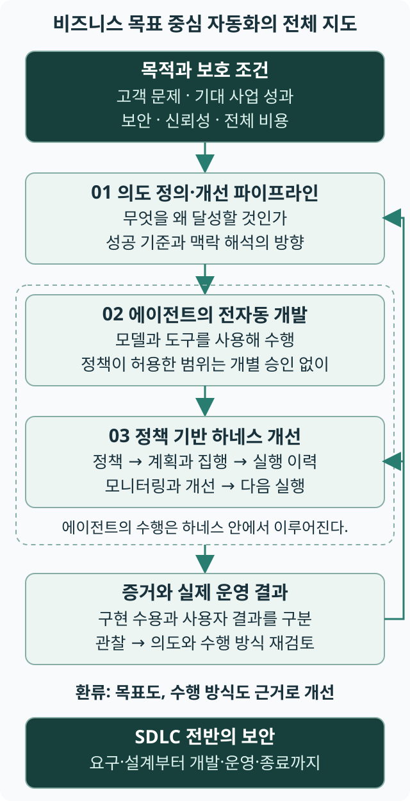

# 1장 코드 생성에서 의도 실현으로

상태: 초고 · 저자 검토 대기

<!-- chapter-tldr:start -->
## TL;DR

- **핵심:** 팩토리는 고객 문제와 사업 성과를 중심으로 개발·운영·개선을 자동화한다. 보안·신뢰성·비용은 결과가 지켜야 할 조건이다.
- **결정:** 의도 정의·개선, 에이전트 수행, 정책 기반 하네스 개선을 연결하고 완전 자동화할 범위를 정한다.
- **확인:** 생성 속도나 배포 성공을 넘어 실제 사용자 결과와 전체 부담을 관찰해 다음 판단을 고친다.
<!-- chapter-tldr:end -->

## 고객의 문제와 사업 성과를 개발의 기준으로 삼는다

소프트웨어 개발의 목표는 고객의 문제를 해결하고 사업에 필요한 변화를 만드는 것이다. 고객이 겪던 불편이 줄었는지, 매출 기회가 늘었는지, 운영 손실이 줄었는지처럼 실제로 달라진 결과를 확인해야 한다. AI로 코드와 문서를 빠르게 만드는 능력도 이 목표를 실현하는 데 쓰여야 한다.

그 결과는 지켜야 할 조건 안에서 만들어져야 한다. 필요한 기능이 동작하면서 보안·신뢰성·성능·운영 비용의 요구도 충족해야 한다. 이 책에서는 이런 품질과 운영의 조건을 비기능 요건이라고 부른다. 고객의 문제를 해결했어도 보호할 정보를 노출하거나 감당할 수 없는 비용을 남겼다면, 의도한 결과를 온전히 실현했다고 판단할 수 없다.

이 책은 원하는 결과와 지켜야 할 조건을 의도로 명시하고, 그 의도를 실행·검증·운영·개선으로 이어가는 소프트웨어 팩토리를 제안한다. 의도는 달성할 결과와 그 이유, 보호할 경계와 성공을 판단할 기준이다. 리더의 일은 이 기준에 따라 자동화할 범위를 정하고, 실제 결과의 증거로 의도와 생산 체계를 계속 고치는 것이다.

## 소프트웨어 팩토리는 무엇을 운영하는가

로보코의 소프트웨어 팩토리는 비즈니스 목표를 중심으로 소프트웨어 개발·운영·개선을 자동화하는 체계다. 보안은 소프트웨어 개발 생명주기(SDLC) 전반에 내재되어야 하며, 각 단계의 통제·증거·책임을 실행 경로에 연결한다. 고객의 문제와 기대하는 사업 성과를 목표로 삼고, 보안·신뢰성·비용 등의 조건을 지키면서 정책이 허용한 범위에서 실행한다. 실제 결과를 관찰해 다음 행동과 실행 방식을 개선한다.

이 비즈니스 목표 중심 자동화를 실현하는 원리는 세 축으로 구성된다. 의도 정의·개선 파이프라인은 목표를 실행 가능한 가설·조건·판정 기준으로 구체화한다. 에이전트의 전자동 소프트웨어 개발은 목표에 필요한 변경을 설계·구현·검증·배포로 이어간다. 정책 기반 하네스 개선 루프는 실행의 경계를 지키고 기록과 관찰을 근거로 수행 방식을 개선한다. 정책은 에이전트와 실행 시스템이 따를 지침과 규칙이며, 자연언어·구조화된 문서 또는 둘의 결합으로 표현하고 실제 판정·행동에 연결한다.

리더가 설계할 것은 그 흐름의 연결이다. 구현이 빨라져도 검증이 결과를 따라가지 못하거나 배포 뒤 문제를 받아줄 책임자가 없다면 전체 생산 체계는 제 역할을 하지 못한다. 이 책은 접수·수행·판정·운영의 각 경계에서 무엇을 제공하고 누가 다음 결정을 내릴지 설명한다.

팩토리는 제품 팀 안에서 운영할 수도 있고 여러 팀이 일부 기반을 공유할 수도 있다. 특정 모델이나 제품, 중앙 조직 하나를 필수 조건으로 정하지 않는다. 허용한 개발 경로는 에이전트와 자동 실행 도구가 이어 수행하고, 자동 판정과 수용·배포까지 증거로 연결한다. 사업적 약속과 위험에 관한 정책을 정하고 위임 범위를 관리할 책임은 사람에게 남지만, 정책 안의 개별 판단까지 사람이 반복할 필요는 없다.

이 책은 원칙과 정책으로 허용한 범위에서 사람의 개별 승인 없이 완전 자동화하는 것을 목표로 한다. 요청 접수 뒤 실행을 허용할지 판단하는 단계부터 작업 분해·수행·검증·수용·반영·배포를 연결하고, 정책이 처리 방법과 한도를 정한 예외·재시도·복구도 자동으로 수행할 수 있다. 자동으로 처리할 범위와 사람이 판단할 범위는 원칙과 정책으로 나눈다. 일부 단계의 자동화는 그 범위의 완전 자동화로 가는 도입 단계다. 의도·정책과 위임 범위를 정하는 책임, 운영 결과에 대한 책임과 개별 실행의 승인은 다른 개념이다.

세 축은 같은 비즈니스 목표에 연결되어야 한다. 탐색과 운영에서 얻은 증거가 의도를 고치고, 갱신된 의도가 실행 계약(작업을 맡기는 조건과 결과를 수용하는 조건을 연결한 합의, [5장](ch05.md))과 개발 작업으로 이어져야 한다. 하네스는 정책 → 계획과 집행 → 실행 이력 → 모니터링·개선의 사이클로 그 수행을 감싼다. 의도 파이프라인은 [2장](ch02.md), 의도 파이프라인과 하네스 개선 루프라는 두 개선 루프의 관계는 [4장](ch04.md), 하네스의 운영은 [9장](ch09.md)과 [19장](ch19.md)에서 구체화한다.

예를 들어 목표가 문의 해결 시간을 줄이는 것이라면 답변 기능을 배포한 뒤에도 실제 해결 시간과 답변 품질, 정보 보호와 운영 비용을 관찰해야 한다. 그 증거로 다음 개선을 실행할지, 더 조사할지, 중단할지 판단한다. 정책으로 위임한 판단은 자동으로 수행할 수 있으며, 위임하지 않은 약속이나 위험의 선택은 책임자에게 연결한다. 사업 성과에는 시장과 조직의 변화도 영향을 주므로, 이 체계의 도입만으로 목표 달성을 보장하거나 모든 성과를 자동화의 효과로 돌리지는 않는다.

## 보안을 유지할 필수 운영 기반으로 본다

이 책은 소프트웨어 팩토리가 지속적으로 소프트웨어를 개발하고 운영하는 조직에서 보안을 유지하기 위한 필수 운영 기반이 될 것으로 본다. 고객 정보와 서비스의 지속성을 보호하려면 취약점을 알아낸 뒤 수정·검증·배포로 이어지는 대응과, 새 변경이 보호 경계를 넘지 못하게 하는 통제가 함께 필요하다. 생성된 코드를 얼마나 빨리 만들었는지뿐 아니라 어떤 변경을 어떤 조건에서 운영에 반영할 수 있는지까지 생산 체계가 다뤄야 한다.

NIST의 2022년 안전한 소프트웨어 개발 프레임워크(SSDF)는 보안 실무를 각 소프트웨어 개발 생명주기에 통합하도록 권고한다.[S135] 소프트웨어 팩토리를 의무화한 지침은 아니다. 이 책은 그 필요성을 의도·정책·실행·검증·운영 관찰을 연결하는 팩토리의 설계 과제로 구체화한다. 보안 기준을 정책에 적는 데서 끝내지 않고, 허용하지 않은 요청과 행동을 차단하며 검사와 증거가 빠진 변경을 보류할 수 있어야 한다.

이 전망은 특정 도구의 도입만으로 보안을 확보한다는 뜻이 아니다. 기존 조직이 갖춘 보안 개발·배포·대응 능력을 유지하면서 부족한 연결을 보완하고, 실제로 보호 경계를 지키는지 시험해야 한다. [12장](ch12.md)은 생산 흐름에 내재할 통제를, [17장](ch17.md)은 대응 시간과 남은 위험을, [18장](ch18.md)은 기존 서비스 전환과 신규 구축의 도입 조건을 다룬다. 이 관점에서 팩토리는 비즈니스 목표를 빠르게 실현하는 체계이자 그 결과를 안전하게 지속할 기반이다.

## 모델·에이전트·하네스가 함께 일한다

이 책에서 다루는 AI 기반 소프트웨어 팩토리는 모델·에이전트·하네스를 필수 구성으로 본다. 이는 세 개의 독립 제품을 구매해야 한다는 뜻이 아니라, 생산 체계 안에서 갖추어야 할 역할을 구분한 것이다. 에이전트는 모델과 하네스, 도구를 결합해 목표를 수행하는 주체다.

| 구성 | 맡는 역할 | 리더가 확인할 것 |
|---|---|---|
| 모델 | 주어진 맥락에서 내용을 해석하고 다음 행동이나 결과를 생성한다. | 맡길 업무에 필요한 능력·비용·한계 |
| 에이전트 | 목표와 역할에 따라 도구를 사용하고 결과를 확인하며 작업을 이어간다. | 맡긴 결과·협력 범위·완료와 이관 조건 |
| 하네스 | 정책·계획과 집행·실행 이력·모니터링과 개선을 연결한다. 실행 기반은 그 안에서 맥락·도구·상태·검증을 이어준다. | 정책의 집행·기록의 가시성·외부 신호·개선 효과 |

모델의 응답을 실제 행동과 다음 판단으로 이어주는 장치가 있어야 반복 수행을 맡길 수 있다. 여기서 에이전트의 실행 기반은 하네스 사이클을 실제로 작동시키는 부분이다. 검사를 돌리는 장치뿐 아니라 그 검사의 기준, 실행 이력, 다음 기준을 고치는 책임까지 연결해야 한다. 자료가 없어도 계속 진행하거나 도구 오류를 성공으로 넘기고 이전 작업을 잃어버리는 실행이라면 모델의 능력만으로 운영의 신뢰를 설명하기 어렵다.

세 역할은 한 도구 안에 묶여 있을 수도 있고 여러 서비스에 나뉠 수도 있다. 리더는 구성요소의 이름보다 실제로 어떤 조건을 누가 집행하고 실패 뒤 무엇을 이어받을 수 있는지 확인한다. 9장은 하네스를 포함한 팩토리의 책임 구조를, [11장](ch11.md)은 이 조합의 능력을 평가하는 방법을 다룬다.

그림 1-1. 비즈니스 목표가 자동화의 방향을 정한다. 세 원리는 이 목적을 지탱하며, 배포 이후의 사용자 결과까지 다음 판단에 연결한다. [다이어그램 크게 보기](../figures/factory-overview.svg).

## 구현 예제에서 판단의 연결을 읽는다

이 책은 공통 구현 예제로 로보코의 [The Software Factory Demo](https://github.com/roboco-io/the-software-factory-demo)를 사용한다. 글을 작성하고 읽는 예제 서비스를 대상으로 요청·구현·검토·검사·병합·배포를 연결한 공개 프로젝트다.[S98] 뒤의 장은 이 흐름에서 요청의 충분성, 수정 증거, 사람에게 돌아오는 판단, 실패 뒤의 기준 변경을 각각 살펴본다. 코드를 읽기 전에 [독자용 데모 해설](../demo/index.md)에서 질문별 흐름과 구현 근거를 찾아볼 수 있다. [배포된 데모](https://roboco.io/the-software-factory-demo/)에서 실제 화면을 살펴볼 수 있다.

파일이 존재하는 사실, 코드가 정한 조건, 공개 실행 기록에서 확인한 결과를 구분해 읽는다. 이 책에서 서비스를 직접 실행하거나 조직 생산성을 측정한 것은 아니다. 다른 조직은 자신의 사용자 결과와 권한·복구 조건에 맞는지 판단해야 한다. 구현 예제의 출처와 확인 범위는 [참고문헌](../../research/sources.json)과 각 데모 해설에 기록했다.

## 결과 단위를 먼저 선택한다

자동화의 출발점은 도구를 많이 배포하는 일이 아니라 관찰할 결과를 선택하는 일이다. 예를 들어 사내 문의의 답변 초안 업무를 생각해 보자. 초안이 빨리 나오는 것만 측정하면 근거가 없거나 오래된 내용을 담은 답변도 성과가 될 수 있다. 정확한 근거를 찾고 필요한 판단을 남겨 문의 처리에 쓰이는 결과를 확인해야 한다.

리더는 사용자 결과, 품질의 경계, 전체 비용과 남은 인간 판단을 함께 정한다. 업무마다 확인 가능한 시점도 다르다. 구현 직후의 검사와 실제 사용에서의 결과를 구분해 누가 언제 다시 볼지 연결한다. 확인할 수 없는 효과는 기대나 가설로 남기고 이미 달성한 성과로 보고하지 않는다.

| 선택할 대상 | 리더가 정할 것 | 관찰할 것 |
|---|---|---|
| 업무 결과 | 누구의 어떤 문제를 해결하는가 | 수용한 결과와 실제 사용 |
| 허용 경계 | 무엇을 위임하고 무엇을 보존하는가 | 권한 밖 행동·예외·복구 |
| 판정 | 어떤 증거로 누가 받아들이는가 | 누락·오류·판정 번복 |
| 투자 | 어떤 역량과 기반을 개선하는가 | 전체 비용·대기·재작업 |

이 표는 이 책의 도입 판단 기준이다. 표의 판정 번복은 이미 받아들인 결과를 나중에 다시 판정해 수용을 취소하거나 범위를 바꾸는 일이다. 모든 업무에 같은 지표를 적용하는 제안은 아니다. 결과의 성격과 실패 영향에 맞춰 기준을 정하고, 측정하기 쉬운 활동이 목적을 대신하지 않는지 살핀다.

결과 단위를 먼저 고르는 방식에도 비용이 있다. 결과를 확인할 시점까지 판단을 미뤄야 하고, 기준과 판정 기록을 유지하는 일이 생긴다. 이 책은 관찰의 깊이를 결과의 영향과 반복성에 맞추도록 제안한다. 영향이 작고 반복되는 업무는 짧은 결과 기록으로 시작하고, 영향이 크거나 되돌리기 어려운 업무에 더 깊은 확인을 둔다. 측정 자체의 비용을 다루는 기준은 [17장](ch17.md)에서 구체화한다.

## 모델 의존을 줄이려면 운영 조건이 필요하다

좋은 모델은 수행할 수 있는 업무와 비용, 속도에 영향을 준다. 팩토리를 구축해도 그 차이가 사라지지는 않는다. 이 책이 지향하는 것은 특정 모델이 바뀌어도 목적과 수용 기준을 유지하고 품질 변동을 발견할 수 있는 체계다. 모델의 최소 수행 능력과 작업 환경의 적합성을 확인해야 모델이 바뀐 뒤에도 업무를 맡길 수 있다.

P01 ‘의도의 명시화’는 기준과 책임을 드러낸다. 수행자를 선별하고 필요한 맥락을 공급하며, 결과를 별도 기준으로 판정하고 실패를 복구할 수 있어야 명시한 기준이 실제로 유지된다. 규칙을 많이 적거나 모든 결과에 사람의 승인을 붙이는 것만으로 이를 대신할 수는 없다.

완전 자동화의 가능성은 [3장](ch03.md)에서 다룰 원칙·정책과 수행 증거로 판단한다. 영향이 크거나 예외라는 이유만으로 사람 승인 대상으로 고정하지 않으며, 필요한 증거·권한·중단·복구 조건을 갖췄는지 확인한다. 사람이 판단하도록 정한 조건이나 허용 범위를 벗어난 변경은 해당 책임자에게 넘긴다. 조건을 확인하지 못한 상태는 자동 승인하지 않고 보류한다. 정한 범위의 자동화 목표와 모든 상황에서의 성공 보장은 구분한다.

## 사람의 판단과 조직의 흐름을 함께 설계한다

수행이 빨라져도 승인과 인계, 재설명에 시간이 걸릴 수 있다. 커뮤니케이션 비용은 메시지의 개수보다 필요한 판단과 맥락을 전달하는 부담으로 본다. 이미 정한 기준을 다시 찾는 비용과 새로운 문제를 발견할 협의를 구분해야 한다. 전자를 줄이면서 후자의 통로를 유지하는 것이 과제다.

조직 개편은 그 병목을 확인한 뒤 판단한다. 정보 접근과 권한을 정리하는 것으로 해결할 수 있다면 팀 경계를 바꾸지 않아도 된다. 반대로 결과 책임과 결정 권한이 계속 분리되어 대기와 책임 공백을 만든다면 경계의 재설계를 검토할 근거가 생긴다. 조직도 변경 자체를 자동화의 성과로 보지 않는다.

사람에게도 목적과 결과에 기여할 역할이 필요하다. 기준을 선택하고 잘못된 결과를 거부하며 실패를 개선할 실제 권한과 역량을 연결한다. [16장](ch16.md)은 오너십·인지적 참여·책임 행동을 나누어 이 업무 설계를 다룬다. 자동화를 줄인 양으로 사람의 역할이 보존되었다고 판단하지 않는다.

## 작은 실행 루프에서 가설을 검토한다

P15 ‘검증을 거치는 개선’은 실패를 분류하고 변경안을 같은 기준으로 확인하도록 제안한다. 처음에는 목적과 결과를 설명할 수 있고 영향과 복구 범위를 제한할 업무를 고른다. 필요한 질문과 개입, 판정 대기와 결과의 품질을 살펴보고 다음에 바꿀 조건을 정한다. 도구 사용률만으로 확대를 결정하지 않는다.

이 책의 패턴은 이미 효과가 입증된 보편 법칙이 아니다. 적용 맥락과 상충하는 요구, 해결 구조와 비용, 실패 조건과 검증 방법을 함께 읽어야 한다. 공개 자료의 관찰과 업체의 보고, 저자의 해석과 제안을 구분하며 자신의 업무에서 가설을 시험한다.

리더는 자동화로 무엇을 해결하려는지 선택하고 그 결과를 판단할 기준을 유지한다. 다음 장은 의도를 일회성 요청에 머물게 하지 않고 이후의 수행과 수용, 개선에서도 접근할 수 있는 기준으로 만드는 방법을 다룬다.

## 출처와 검토

[S135] · [S98]. 확인 범위와 한계는 [출처 대장](../../research/sources.json), 주장 유형은 [주장 메모](../../research/claims/ch01.json)에 기록한다. 이 장의 적용 방법은 저자 제안이며 실제 조직의 인과 효과·패턴 효과·참고 도서 본문 대조·편집 확정은 완료하지 않았다.

『More Effective Agile』과의 주제 연결은 [연구 대응 지도](../../research/mcconnell/chapter-map.md)에 있다. 연결 범위는 참고 도서의 공개 목차이며, 참고 도서 본문을 대조하지 않았다. 연결 내용은 참고 도서의 주장이 아니라 이 책의 재고찰 질문이다.
