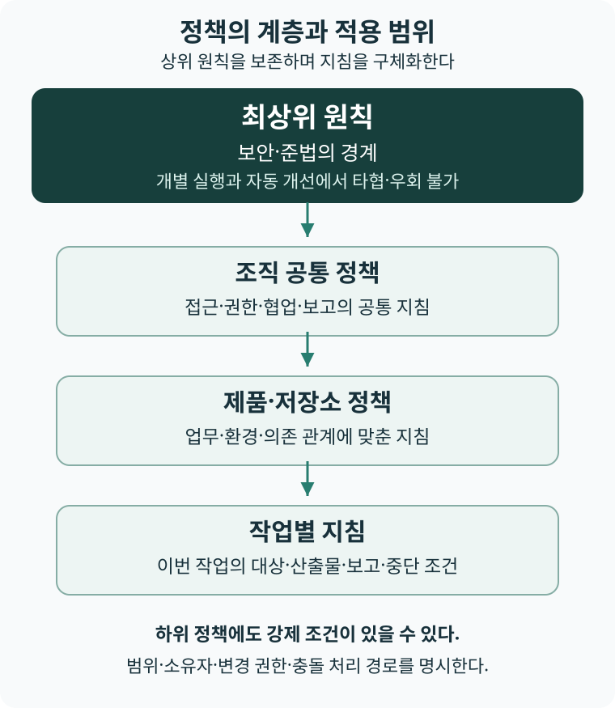

# 3장 정책과 실행계획을 분리한다

상태: 초고 · 저자 검토 대기

## 방법을 맡길 때 함께 넘어가는 것

리더가 실행을 위임할 때 어려운 문제는 작업 순서를 정하는 일만이 아니다. 수행자가 방법을 바꾸다가 지켜야 할 약속까지 바꾸는 일을 어떻게 알아볼 것인가. 계획대로 진행하기 어려울 때 일정과 범위를 조정할 수는 있다. 그러나 어떤 조정이 실행자의 권한에 속하고 어떤 조정이 새로운 사업 판단을 요구하는지 불분명하면, 조직은 매번 승인을 기다리거나 경계를 넘어선 결과를 뒤늦게 발견한다.

예를 들어 고객 정보 조회 방식을 개선하는 작업을 생각해 보자. 이는 원리를 설명하기 위한 가상 상황이며 실제 고객 사례가 아니다. 실행자는 검색 방식과 작업 순서, 사용할 도구를 바꿀 수 있다. 하지만 편의를 위해 고객 정보를 허용되지 않은 외부 서비스로 보내는 결정은 다른 성격을 갖는다. 방법의 변경이 정보 취급의 경계를 바꾸기 때문이다. 결과가 빨리 나왔다는 사실만으로 그 변경을 수용할 수는 없다.

이 책에서 정책은 에이전트와 실행 시스템이 업무를 수행할 때 따르는 지침과 규칙이다. 기대하는 행동과 허용 경계, 권한·협업·보고·검증의 조건을 담는다. 실행계획은 그 지침 아래에서 이번 작업과 방법을 조직한다. P02 ‘정책과 계획의 분리’의 중심은 문서를 둘로 나누는 데 있지 않다. 수행 방법을 고칠 권한과 허용 경계를 고칠 권한을 구분하고, 각각의 변경을 서로 다른 증거로 판단하는 데 있다. 정책과 계획을 별도 파일에 기록해도 실행자가 양쪽을 함께 완화할 수 있다면 이 구분은 작동하지 않는다.

## 정책은 경계를 정하고 계획은 경로를 선택한다

2장에서 의도는 달성할 결과와 그 이유를 연결했다. 정책은 그 의도에 따라 에이전트가 무엇을 지키며 어떻게 행동해야 하는지 정한다. 권한과 금지 범위뿐 아니라 협업·보고·확인의 조건, 충돌 시 우선순위도 포함한다. 실행계획은 현재 조건에서 어떤 작업을 어떤 순서로 수행하고 결과를 어떻게 확인할지 정한다. 의도에 비추어 필요한 경계를 정책으로 구체화하고, 그 경계 안에서 목적에 도달할 경로를 계획으로 선택하는 관계다.

어떤 조건이 정책인지는 표현의 단호함으로 판단하기 어렵다. 같은 도구를 사용하라는 문장도 선택의 이유에 따라 달라진다. 현재 팀이 익숙해서 선택했다면 계획의 판단일 수 있다. 계약상 허용된 처리 환경을 유지하기 위한 조건이라면 정책의 판단일 수 있다. 리더는 조건을 어겼을 때 누구의 약속과 위험이 바뀌는지 묻고, 그 변경을 결정할 권한을 배치해야 한다.

| 구분 | 정책 | 실행계획 |
|---|---|---|
| 답할 질문 | 어떤 지침과 권한에 따라 일해야 하는가 | 현재 작업을 어떤 순서와 방법으로 수행할 것인가 |
| 변경의 근거 | 위험·약속·사업 조건의 변화와 경계 변경의 영향 | 작업 증거·의존성·실행 가능성의 변화 |
| 변경 권한 | 해당 위험과 약속을 책임지는 주체 | 정책 범위 안에서 위임받은 실행 주체 |
| 검증의 대상 | 필요한 경계를 빠뜨리지 않았는지와 실제로 적용되는지 | 선택한 방법이 실행 가능하며 경계와 결과 기준을 충족하는지 |
| 재검토 시점 | 경계를 정당화한 조건이 달라지거나 예외가 반복될 때 | 실행 중 새 정보와 장애를 발견할 때 |

이 구분은 이 책의 설계 제안이다. 정책은 오래 유지하고 계획은 자주 바꾼다는 시간 차이만으로 정의하지 않는다. 정책도 근거가 바뀌면 즉시 재검토해야 하고, 계획의 일부는 여러 실행에서 재사용할 수 있다. 중요한 것은 변경 빈도보다 변경을 정당화하는 이유와 책임이다.

저자의 「바이브 코딩 시대, 저장소 규칙과 개인 취향의 경계」는 공통 규칙을 개인의 선호와 구분하고 위반했을 때의 영향을 기준으로 판단하자고 제안한다.[S38] 이 책의 정책 검토에도 이 관점을 적용할 수 있다. 책임자가 선호하는 방법이라는 이유만으로 변경 금지의 경계가 되어서는 안 된다. 반대로 겉으로는 형식의 선택처럼 보여도 다른 작업의 계약과 검증이 의존한다면 공통 조건일 수 있다. 리더는 무엇을 고정했는지와 함께 그 조건이 보호하는 약속과 변경 비용을 설명해야 한다.

정책에는 금지와 허용 범위뿐 아니라 무엇을 확인해야 맞는 결과로 받아들일지, 어떤 증거를 남길지, 사람이 무엇을 볼지도 포함한다. AI가 주장한 영향 범위를 뒷받침할 근거와 변경 요약, 미검증 항목의 표시도 정책으로 정할 수 있다. 실행계획은 이 조건을 검사·기록·보고의 실행 경로로 옮긴다. 검증은 정책을 따랐는지 확인하는 수단 중 하나이며 정책의 목적 전체가 아니다. 하네스는 수행 전·수행 중·완료 후에 이 지침을 적용한다. 실행계획과 도구는 제품을 만드는 작업과 정책을 집행하는 경로를 연결한다.

## 정책은 자연언어와 구조화된 규칙으로 표현한다

정책은 문장의 형식보다 어떤 행동과 판단을 정하는지로 구분한다. 에이전트에게 읽히는 자연언어 지침, YAML·JSON 같은 문서에 담은 구조화된 규칙, 두 표현을 함께 쓰는 방식 모두 정책이 될 수 있다. 자연언어만 에이전트의 정책이고 구조화된 규칙은 별개인 것은 아니다. 하네스가 규칙을 평가해 에이전트의 권한과 다음 행동을 제한한다면 그 규칙도 작업에 적용되는 정책이다.

운영 문서의 오탈자를 고치는 업무를 생각해 보자. 먼저 자연언어로 다음처럼 지시할 수 있다.

> 사용자 안내 문서의 오탈자와 띄어쓰기를 고친다. 제품의 동작 설명이나 고객에게 한 약속은 바꾸지 않는다. 현재 변경에 대한 의미 검토와 필수 검사가 통과하면 개별 승인 없이 문서를 반영·배포한다. 허용 범위를 벗어나거나 필요한 결과를 확인하지 못하면 해당 반영을 보류한다.

이 지침은 무엇을 보호하려는지와 문맥을 설명한다. 그러나 ‘의미가 바뀌지 않았다’는 판단에는 해석이 필요하다. 에이전트에게 문장을 읽혔다는 사실만으로 그 판단이 일관되거나 실제 권한 경계가 집행된다고 볼 수는 없다.

그중 명시적으로 확인할 조건을 구조화하면 다음처럼 표현할 수 있다. 아래는 책의 설명용 정책 형식이며 특정 제품의 설정은 아니다.

```yaml
policy_id: docs-copy-edit
version: 1
allowed_paths: ["docs/user-guide/**"]
required_checks: ["docs-build", "link-check"]
required_review:
  meaning_unchanged: true
on_pass: accept_and_publish
on_fail: hold
on_missing: hold
```

이 문서는 허용한 문서 경로, 필요한 검사와 의미 검토 결과, 통과·실패·미확인 뒤의 처리를 정한다. 실제로는 하네스가 변경 파일과 현재 버전의 검사·검토 결과를 수집하고 이 규칙과 대조해야 한다. 에이전트가 ‘검사가 통과했다’거나 ‘의미가 같다’고 쓴 문장을 그대로 확인된 입력으로 쓰지 않는다. 어느 판정 경로가 어떤 변경 버전에 대해 남긴 결과인지 연결한다.

**YAML로 적는 것과 결정론적으로 집행하는 것은 다르다.** YAML은 데이터를 표현하는 형식이다. 같은 규칙·평가기와 같은 입력 상태에서 같은 판단을 내리려면 필드의 의미와 자료형, 누락·오류 처리, 적용 순서를 실행 장치가 정해 두어야 한다. 실제 상태가 바뀌면 판단도 달라질 수 있다. 모델이 내놓은 의미 판단을 입력으로 사용한다면 그 입력 자체에는 오류와 변동이 남는다. 정해진 규칙으로 처리했다고 해서 입력의 참이나 수정 결과의 정확성까지 보장되지는 않는다.

구조화된 정책과 집행을 연결한 공개 예로 Kubernetes의 정책 기능이 있다. 공식 문서는 조건식으로 표현한 검증 규칙과 적용 범위를 연결하고, 요청을 평가해 거부·경고·감사 기록을 남기는 방식을 설명한다.[S111] 여기서 확인한 것은 시스템의 정책 구조이며 에이전트용 자연언어 지침의 효과를 검증한 사례는 아니다.

| 표현 방식 | 맡기기 좋은 내용 | 함께 확인할 것 |
|---|---|---|
| 자연언어 | 목적·이유·문맥·판단 지침 | 해석 차이·모호한 예외·실제 권한 집행 |
| 구조화된 규칙 | 경로·허용 행동·한도·필수 증거·실패 처리 | 규칙의 의미·입력 신뢰성·평가기와 집행 경로 |
| 혼합 | 문맥을 해석하는 판단과 명시적 경계의 결합 | 두 표현의 대응·판본·불일치와 변경 권한 |

이 예의 혼합 방식에서는 자연언어가 의미를 보존할 기준을 설명하고, 별도 검토가 그 기준에 대한 증거를 만든다. 구조화된 규칙은 허용 경로와 필요한 증거를 확인해 자동 반영 또는 보류를 집행한다. 해석 없이 판정할 수 있는 정책은 구조화된 규칙만으로 운영할 수도 있다. 모든 조건을 자연언어로만 두거나, 반대로 모든 판단을 구조화할 수 있다고 가정할 필요는 없다.

두 표현을 함께 쓴다면 같은 정책의 식별자·판본과 보호할 목적을 연결한다. 자연언어의 허용 범위를 고쳤는데 구조화된 규칙은 그대로인 상태를 막고, 정상·금지·미확인 입력으로 대응을 시험한다. 우선순위는 파일 형식이 아니라 상위 원칙과 적용 범위·변경 권한으로 정한다. 구조화된 규칙이 원칙을 우회할 허가가 되거나, 자연언어 설명이 실행 장치의 거부를 임의로 무효화하게 해서는 안 된다. 불일치를 해결하지 못하면 영향을 받는 실행을 보류하고 허용된 보완·이관 경로로 돌린다.

사람의 확인이 필요한지를 분류하는 방식도 명시적 규칙과 문맥 판단으로 나눌 수 있다. **사람에게 넘길지를 자동으로 판정하는 것과 그 결정을 자동으로 승인하는 것은 다르다.** 다음은 두 방식을 구분하기 위한 정책 예시다.

| 사례 | 사람 확인 필요 여부를 정하는 방식 | 사람에게 남기는 결정 |
|---|---|---|
| 권한 설정 변경 | 이 조직이 ‘권한 설정 변경은 지정된 책임자가 확인한다’고 정했다면, 권한 설정의 변경 여부를 명시적 규칙으로 판정해 확인 대기로 보낸다. | 바뀌는 접근 대상·허용 행동·영향을 검토하고 해당 변경을 허용할지 정한다. |
| 비용 관련 트레이드오프 | LLM이 절감액뿐 아니라 응답 시간·품질·가용성·고객 약속에 미치는 영향을 해석하고, 현재 위임 범위로 결정할 수 있는지 분류한다. | 위임 범위를 넘는 경우, 비용 절감과 다른 가치 사이에서 무엇을 우선할지 정한다. |

첫째 사례에서 결정론적으로 처리하는 대상은 사람 확인이 필요하다는 분류다. 권한 변경 자체를 자동으로 허용한다는 뜻은 아니다. 이를 집행하려면 파일 이름만 보는 대신 실제 접근 권한에 영향을 주는 설정과 적용 경로를 식별해야 한다. 변경 여부를 확인할 수 없다면 자동 통과시키지 않는다. 이 예시는 조직이 선택한 정책이며, 모든 권한 변경에 언제나 사람 확인이 필요하다는 보편 원칙은 아니다.

둘째 사례에서는 월 비용을 줄이기 위해 응답 지연을 늘리거나 복구 능력을 낮추는 선택을 생각해 볼 수 있다. LLM은 대안·영향·근거와 불확실성을 정리하고 사람의 판단이 필요한지 분류할 수 있다. 그러나 정책이 사람에게 유보한 고객 약속의 변경을 모델이 스스로 승인할 수는 없다. 반대로 비용·품질·응답 시간의 허용 범위가 이미 정해져 있고 필요한 증거를 갖췄다면 그 범위 안의 선택은 자동 처리할 수 있다. ‘비용 문제’라는 이름만으로 전부 사람에게 넘기지 않는다.

두 방식을 함께 쓸 때는 명시적 규칙이 요구한 사람 확인을 LLM의 판단으로 해제하지 않는다. 규칙이 처리하지 못한 문맥은 모델이 분류하되, 그 판단의 근거와 적용 정책을 남긴다. 모델 판단이 없거나 근거가 부족하면 실행을 보류하고 허용된 보완·이관 경로를 따른다. 운영에서는 권한 변경의 분류 누락, 비용 판단의 잘못된 자동 처리와 불필요한 이관을 각각 관찰해 분류 정책을 고친다.

## 원칙과 적용 범위별 정책을 연결한다

정책의 최상위에는 개별 작업의 편의를 위해 타협할 수 없는 원칙을 둔다. 보안이나 준법처럼 조직이 반드시 지켜야 하는 경계가 여기에 해당한다. 작업이 급하거나 검사가 자주 실패한다는 이유로 에이전트가 그 원칙을 완화할 수는 없다. 보호할 원칙과 그 원칙을 지키는 구체적인 수단은 구분한다. 원칙은 유지하면서 정보 접근·검토·보고의 방법을 개선할 수 있다.

정책은 적용 범위에 따라 세분화해 관리한다. 다음은 조직 공통 정책, 제품·저장소 정책, 작업별 지침으로 이어지는 예시다. 모든 조직이 같은 단계 수를 갖춰야 한다는 뜻은 아니다. 한 저장소가 여러 제품을 지원하거나 보안 정책이 여러 업무에 걸치면 적용 범위가 겹칠 수 있으므로 상속할 지침과 충돌 처리 순서를 명시한다.



그림 3-1. 적용 범위에 따른 정책의 구체화. 저자의 설계 제안이다. [다이어그램 크게 보기](../figures/policy-hierarchy.svg).

| 계층의 예 | 맡는 역할 | 지침의 예 |
|---|---|---|
| 최상위 원칙 | 타협할 수 없는 경계를 정한다. | 허용되지 않은 정보 공개와 권한 행사를 금지한다. |
| 조직 공통 정책 | 원칙을 공통 업무에 적용한다. | 정보 접근·협업·보고의 책임과 경로를 정한다. |
| 제품·저장소 정책 | 업무와 환경의 조건을 구체화한다. | 공용 API의 호환성 유지와 배포 조건을 정한다. |
| 작업별 지침 | 이번 작업의 범위에 적용한다. | 바꿀 대상·산출물·보고·중단 조건을 정한다. |

적용 범위와 강제성은 다른 구분이다. 하위 정책에도 반드시 지킬 조건이 있을 수 있고, 권고로 두는 항목이 있다면 그 여부를 표시해야 한다. 더 구체적이거나 나중에 작성된 지침이라는 이유만으로 상위 원칙을 무효화하지 않는다. 상위 원칙과 충돌하거나 같은 범위의 지침을 함께 지킬 수 없다면 수행자는 해당 실행을 보류하고 충돌한 지침·근거·가능한 대안을 판단 책임자에게 전달한다.

각 정책에는 보호할 목적, 적용 범위와 상위 지침, 소유자와 변경 권한, 유효한 판본, 실제 집행·확인 경로를 연결한다. 여러 층에 같은 문장을 복사하면 기준이 어긋날 수 있으므로 공통 지침은 참조하고 해당 범위의 구체화만 남긴다. 지침을 찾고 충돌을 해소하는 비용도 유지 비용에 포함한다.

이후 본문에서 정책의 예외를 다룰 때에도 상위 원칙은 보존한다. 예외 권한은 위임된 하위 조건을 조정할 권한이며 원칙을 위반할 허락은 아니다. 원칙과 충돌하면 실행 방법이나 범위를 바꾸거나 중단한다.

보안 원칙을 지속해서 지키려면 적용 범위별 정책이 실제 차단·보류·이관으로 이어져야 한다. 그 적용 범위는 구현과 배포에 한정하지 않고 요구·설계·검증·운영·종료를 포함한 SDLC 전반으로 정한다. 실행자가 자신의 변경을 통과시키려고 검사나 배포 규칙까지 바꾸지 못하게 하고, 필요한 정책 변경은 별도의 변경 권한과 평가 경로로 다룬다. 긴급 수정도 이 경계 안에서 수행한다. 이 책은 그 집행과 기록을 팩토리의 보안 운영 기반으로 보며, 사람의 주의나 문서상의 당부만을 집행 수단으로 두지 않도록 제안한다.

## 완전 자동화할 범위를 원칙과 정책으로 나눈다

정책은 자동 실행을 막을 목록뿐 아니라 사람의 개별 승인 없이 끝까지 처리할 범위를 정한다. 대상·입력·행동·자원과 완료 증거가 명확하고, 실제 권한과 상태 확인·중단·복구 조건을 갖췄다면 요청 접수부터 수용·반영·배포까지 자동으로 이어갈 수 있다. 이 조건을 충족하는지는 하네스가 작업마다 판정할 수 있다. 원칙을 위반하거나 적용 정책이 사람에게 유보한 판단은 자동 범위에 넣지 않는다.

| 적용 상태 | 처리 방식 | 남길 근거 |
|---|---|---|
| 정책이 허용하고 필요한 증거·권한·복구 조건을 충족함 | 개별 승인 없이 수행·판정·수용·배포와 허용된 예외 처리를 이어간다. | 적용 기준·자동 판정·실제 결과·복구 이력 |
| 정책이 사람에게 판단을 유보하거나 위임한 경계 밖의 변경이 필요함 | 해당 판단의 책임자에게 넘긴다. | 판단할 조건·확인한 증거·선택지·허용 범위 |
| 금지·충돌·증거 부족으로 실행 가능 여부를 확인하지 못함 | 해당 실행을 보류·중단하고 허용된 보완·영향 제한·복구만 수행한다. | 중단 이유·남은 상태·보완 또는 이관 조건 |

정상과 예외는 사건의 분류이고 자동과 사람은 처리 주체의 분류다. 정책이 복구 방법과 한도까지 정한 예외는 자동으로 처리할 수 있다. 정상처럼 보이는 결과도 위임하지 않은 판단을 요구하면 사람에게 넘긴다. 위험 등급이 높다는 이유만으로 항상 사람 승인을 붙이거나, 낮다는 이유만으로 증거를 생략하지 않는다. 필요한 조건의 엄격함과 충족 여부로 판단한다.

자동화할 수 있는 범위도 조건이 바뀌면 다시 평가한다. 정책·기준·실행 환경의 버전, 증거를 확인할 경로, 자원 한도와 종료 상태를 연결한다. 사람이 사전에 위임 범위를 정하는 일과 범위 안의 실행을 매번 승인하는 일은 다르다. 전자의 책임을 남기면서 후자의 대기를 없애는 것이 이 책의 방향이다.

## 계획을 바꾸는 권한을 구체적으로 위임한다

2장에서 소개한 Intent Engineering은 구현 방법을 의도와 구분해 위임할 것을 제안한다.[S69] 이 책은 그 문제의식을 이어받되 방법이 이미 계약·호환성·정보 취급의 약속인 경우에는 책임자가 정한 제약으로 다룬다. 같은 기술 선택도 탐색 가능한 대안인지 지켜야 할 경계인지에 따라 위임 권한이 달라진다. 의도 문서에서 구현 세부를 줄이는 일과 약속의 제약을 없애는 일을 혼동하지 않는다.

계획 조정 권한을 준다는 말에는 조정 가능한 대상이 들어 있어야 한다. 작업 순서, 담당 실행 주체, 사용 도구를 바꿀 수 있는지 정하고, 그 변경이 다른 작업의 입력이나 완료 기준에 영향을 줄 때 누구에게 알릴지도 정한다. 실행자가 변경 가능한 범위를 알면 경계 안의 작은 조정마다 리더에게 돌아오지 않아도 된다. 리더는 방법의 세부 선택보다 위임 범위와 결과 판정에 집중할 수 있다.

앞의 가상 상황에서 실행자가 대안적인 조회 방식을 찾았다고 하자. 허용된 환경에서 처리하고 기존의 결과 기준을 충족한다면 계획을 조정할 수 있다. 외부 전송이 필요하거나 약속한 정보 범위를 바꾸어야 한다면 정책 판단으로 넘긴다. 이때 실행자는 실행을 막은 조건, 검토한 대안, 경계를 바꾸지 않고 진행할 수 있는 부분을 제시한다. 책임자는 그 정보를 바탕으로 예외를 허용할지, 범위를 줄일지, 중단할지 결정한다.

계획 검증에는 해당 작업의 결과 확인과 정책 준수 확인이 함께 필요하다. 방법을 교체했는데 기존 검증이 사라졌다면 새 계획이 같은 약속을 지킨다고 판단하기 어렵다. 반대로 기존 검사가 특정 구현 방법에만 묶여 있다면 대안에 맞는 검증 방법을 제안할 수 있다. 검사 방법을 바꾸는 권한과 수용 기준을 낮추는 권한도 구분해야 한다. 검사 변경이 동일한 기준을 충분히 확인하는지는 결과 수용 권한을 가진 주체가 판단한다.

## 공개 구현에서 확인할 수 있는 경계

GitHub의 공식 문서는 저장소 규칙으로 브랜치와 태그의 변경 조건을 정하고, 규칙 편집 권한과 일부 주체의 우회 권한을 설정할 수 있다고 설명한다. 적용 중인 여러 규칙은 함께 작동하며, 집행 상태를 바꾸는 기능도 제공한다.[S16] 이는 제품이 제공하는 구조에 관한 문서 확인이다. 특정 조직이 이 구조를 어떻게 운영했고 어떤 성과를 얻었는지는 여기서 확인하지 않았다.

이 구조에서 얻을 수 있는 해석은 작업 방법과 변경 수용 조건을 따로 관리할 수 있다는 것이다. 실행자가 해결 방법을 선택해도 변경을 수용하는 경계는 별도의 장치에 남길 수 있다. 다만 규칙을 끄거나 우회할 수 있는 권한까지 실행자에게 주면 경계의 효력은 달라진다. 이 책은 자동화의 권한을 정할 때 일반 실행 권한과 규칙 변경·예외 권한을 함께 점검하도록 권한다. 규칙의 존재와 그 규칙이 모든 실행에 적용된다는 사실은 별도로 확인해야 한다.

Anthropic은 2025년 10월 공개 글에서 파일과 네트워크 접근의 범위를 제한하는 실행 환경을 설명했다. 정해진 범위 안에서 에이전트가 작업하고, 경계 밖의 접근은 별도 허용 판단으로 연결하는 구조다.[S17] 여기서 확인한 것은 업체가 설명한 설계이며 이 책에서 도구를 설치하거나 실행해 검증한 결과는 아니다. 업체가 제시한 성과 수치는 이 장의 효과 근거로 사용하지 않는다.

이 설명에서 얻을 수 있는 해석은 모든 행동을 개별 승인하는 대신, 허용 범위를 먼저 정하고 범위를 넘는 행동을 판단 대상으로 남길 수 있다는 것이다. 다만 접근을 허용하는 경계가 결과의 정확성이나 사업적 타당성까지 보장하지는 않는다. 실행 경계를 정하는 판단과 결과를 수용하는 판단을 연결해야 한다. 이 책의 P02는 이 관계를 조직의 책임으로 확장한 제안이며, 두 제품 사례가 P02의 보편적 효과를 입증한다고 주장하지 않는다.

## 정책을 바꾸는 변경도 분류한다

데모는 바뀐 파일의 위험에 따라 자동으로 처리할 경계를 달리한다. 위험 정책이 경로별 등급과 필요한 검사를 정하고, 분류 코드가 변경 전체의 위험을 모아 병합 판단에 넘긴다. 팩토리 자체의 지침·워크플로를 바꾸는 변경은 일반 제품 변경보다 높게 분류한다.[S100] 이는 만들 기능을 선택하는 일과 그 변경을 반영할 조건을 관리하는 일을 나누는 예다. 여기의 위험 등급은 이 장의 정책 적용 범위 계층과 다른 구분이다. 파일 사이의 연결과 한계는 [데모 해설: 정책에서 반영 판단까지](../demo/policy-and-gate.md)에서 읽을 수 있다.

리더는 정책 파일이 따로 있는지만 볼 것이 아니라 그 파일을 바꾸면 누구의 판단이 필요한지 확인한다. 규칙이 지키는 약속과 정책 변경의 검증이 연결되어야 한다. 경로는 이 구현이 선택한 위험 판별 수단이며 실제 사용자 영향과 항상 일치하는 보편 기준은 아니다. 12장은 이 분류가 병합 판단에 연결되는 조건과 한계를 살펴본다.

## 실행 계약으로 연결을 유지한다

정책과 계획을 분리하면 어느 정책에 따라 어떤 계획을 실행했는지 다시 연결해야 한다. 연결이 없으면 최신 정책을 읽고 과거 실행을 판단하거나, 새 계획에 이전의 권한이 그대로 적용된다고 오해할 수 있다. 이 책은 P03 ‘실행 가능한 계약’으로 작업에 필요한 입력과 출력, 권한, 완료 증거, 실패 처리를 묶도록 제안한다. 실행 계약은 실행에 적용하는 기준을 식별하고 필요한 순간에 확인할 수 있게 하는 구조다.

계약에는 작업의 목적과 산출물, 적용할 정책의 버전, 계획의 버전, 허용된 조정 범위, 결과 수용의 근거를 연결한다. 진행 중 계획을 바꾸면 새 계획이 보존한 경계와 변경 이유를 남긴다. 정책을 바꾸면 적용을 시작할 시점과 영향을 받는 진행 작업을 결정한다. 긴 실행의 중간에 기준이 바뀌었다면 계속할지, 다시 검증할지, 중단할지를 명시해야 한다. 버전 번호만 남기는 것으로 이 판단을 대신할 수는 없다.

계약의 내용은 실행 주체가 실제로 확인할 수 있어야 한다. 자동 검사로 확인할 조건은 실행과 판정에 연결하고, 해석이 필요한 조건은 판단 책임자와 필요한 증거를 연결한다. 사람과 에이전트가 같은 문장을 읽는다고 같은 판단을 한다고 가정해서는 안 된다. 서로 다른 실행 주체에게 작업을 맡겼을 때 어떤 질문과 경계 해석의 차이가 발생하는지 관찰해야 계약의 부족한 부분을 찾을 수 있다.

## 예외가 정책을 지우지 않게 한다

정책이 현실을 빠뜨릴 수 있으므로 예외 절차는 필요하다. 그러나 예외를 허용한다는 판단과 정책 전체를 변경한다는 판단은 다르다. 예외에는 대상 작업, 허용할 행동, 이유, 결정 책임자, 종료 조건을 붙인다. 적용 범위가 좁더라도 다른 사용자나 팀이 부담할 위험을 확인해야 한다. 실행자가 자신의 장애를 없애기 위해 다른 주체의 약속을 바꿀 수는 없다.

같은 예외가 반복되면 정책이 지나치게 좁거나 계획에 필요한 능력이 부족할 수 있다. 둘을 구분해야 한다. 허용 환경 안에서도 대안이 있었는데 이를 찾지 못했다면 계획과 실행 능력을 검토한다. 경계를 정한 이유가 이미 달라졌다면 정책을 재검토한다. 예외 승인 횟수만으로 어느 쪽이 잘못됐는지 단정하지 않고, 원인과 영향을 확인할 증거를 모은다.

소규모 팀에서는 한 사람이 계획을 바꾸고 정책 예외도 판단할 수 있다. 이때 필요한 것은 직책을 추가하는 일보다 어떤 권한으로 무엇을 바꾸었는지 구분하는 일이다. 다만 한 사람이 놓친 조건을 같은 사람이 계속 수용할 위험은 남는다. 변경의 영향이 크거나 복구가 어려운 경우에는 별도의 검토를 배치할지 판단해야 한다. 권한을 분리하는 정도는 결과의 영향과 검토 비용에 맞춰 정한다.

## 경계를 유지하는 비용도 검토한다

정책과 계획의 분리는 연결 관계를 관리하는 비용을 만든다. 정책의 변경을 실행 계약에 반영해야 하고, 검증 장치가 정책과 어긋나지 않는지도 확인해야 한다. 오래된 기준이 남거나 서로 충돌하는 정책의 적용 순서가 불분명하면 실행자는 문서를 더 읽고도 결정하지 못할 수 있다. 따라서 리더는 정책마다 책임자와 재검토 조건을 정하고, 충돌을 발견했을 때 판단할 경로를 유지해야 한다.

탐색 작업에는 세밀한 계획을 미리 확정하기 어려운 경우가 있다. 이 경우에도 접근 가능한 정보, 허용 자원, 외부에 할 수 있는 약속의 경계는 정할 수 있다. 계획에는 무엇을 알아내려는지와 어떤 관찰 뒤에 다음 작업을 정할지를 담는다. 모든 실험을 완성품의 계약으로 묶으면 학습을 방해할 수 있다. 탐색 결과의 수용 기준과 제품 결과의 수용 기준을 구분해야 한다.

반복할 이유가 적고 영향이 작으며 되돌리기 쉬운 작업에는 별도 정책 체계를 만드는 비용이 더 클 수도 있다. 이 책은 모든 작업에 같은 문서와 승인 절차를 적용하도록 권하지 않는다. 기존 기준을 참조하는 짧은 작업 기록으로 충분한지 먼저 판단한다. 반대로 실행자가 여러 팀의 정보와 자원에 접근하거나 같은 작업을 반복한다면, 경계와 권한을 유지하는 비용을 감수할 이유가 커진다.

## 리더는 무엇을 관찰할 것인가

P02의 유용성을 확인하려면 계획을 바꾼 뒤에도 정책 준수의 검증이 유지되는지 살핀다. 검증 누락, 경계 해석의 반복 질문, 권한 밖 변경, 예외가 끝난 뒤에도 남은 권한을 기록한다. 계획 조정에 걸린 판단 대기와 정책 관리에 새로 들어간 부담도 함께 본다. 경계 위반이 드러나지 않았다는 사실만으로 효과를 확정하지 않는다. 검사가 놓친 조건과 보고되지 않은 예외도 검토할 필요가 있다.

P03은 입력·권한·증거가 실제로 다음 수행과 수용 판단에 쓰였는지 확인한다. 기록이 많아졌는데 질문과 재작업의 이유를 설명하지 못한다면 계약의 구조를 줄이거나 바꾸어야 한다. 리더가 유지할 핵심은 방법을 개선할 자유와 약속을 변경할 책임의 연결이다. 계획을 위임한 뒤에도 결과의 수용과 정책 변경의 책임은 식별할 수 있어야 한다.

참고 도서의 목적 중심 리더십과 규제 환경이라는 주제에 비추어 보면, 이 장의 재고찰 질문은 의도를 전달한 뒤 변경 권한과 판정 책임을 어떻게 유지할 것인가이다. 현재의 대응은 공개 목차를 기준으로 한 주제 연결이며 『More Effective Agile』의 해당 본문을 대조하거나 세부 논증을 평가한 결과가 아니다. 대조 범위는 [연구 대응 지도](../../research/mcconnell/chapter-map.md)에 남긴다.

다음 장은 이 관계를 수행·검증·운영 관찰의 반복으로 연결한다. 정책과 계획의 구분은 한 번의 위임을 명확하게 한다. 의도 실행 루프는 그 실행에서 얻은 증거로 다음 위임의 기준을 고치게 한다.

## 출처와 검토

[S16], [S17], [S38], [S100], [S69], [S111]. 공개 자료의 확인 범위와 한계는 [출처 대장](../../research/sources.json), 주요 주장의 성격과 검토 사항은 [주장 메모](../../research/claims/ch03.json)에 기록한다. 사례의 조직 성과, 실행 검증, 패턴 효과는 확인하지 않았다.
