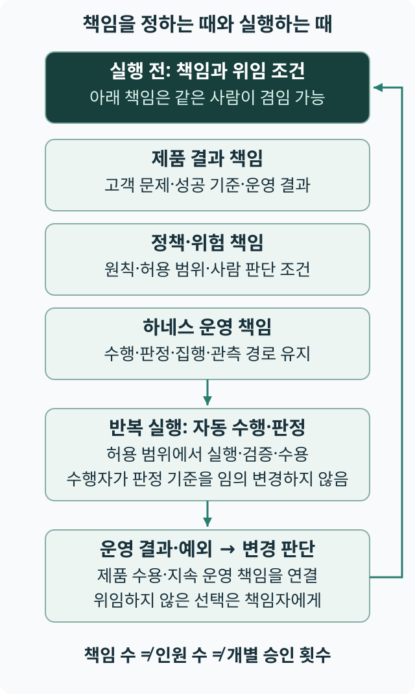
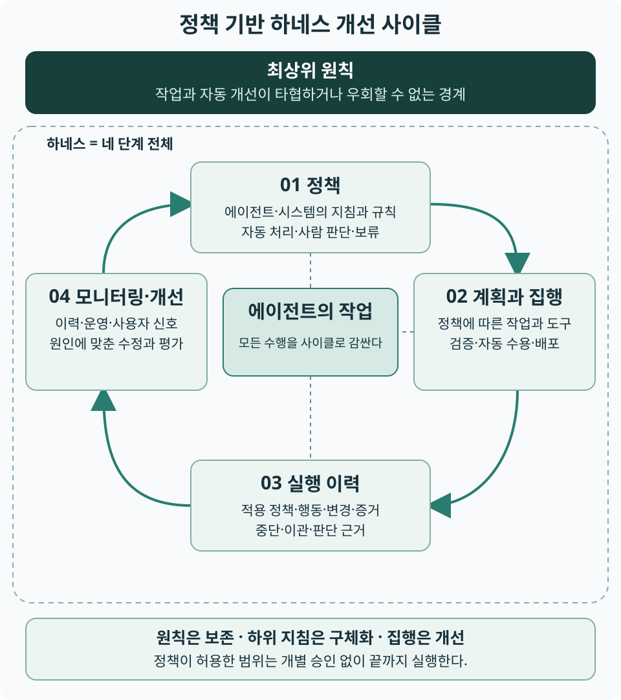

# 9장 팩토리의 책임과 경계를 정한다

상태: 초고 · 저자 검토 대기

<!-- chapter-tldr:start -->
## TL;DR

- 팩토리의 책임은 의도·제품 결과, 정책·위험, 하네스 운영, 수용·지속 운영으로 구분할 수 있다. 이 묶음이 각각의 직책이나 인원수를 뜻하지는 않는다.
- 작은 팀은 책임을 겸임하고 수행·판정을 자동화하며 필요한 전문 지원을 공유할 수 있다. 겸임 자체가 독립성이나 운영 지속성을 보장하지는 않는다.
- 제품의 약속과 공통 기반의 실행 완료는 다른 판단이다. 공유 기반과 제품 팀 사이의 입력·증거·수용·예외 책임을 연결한다.
- 모델·에이전트·하네스의 관계에서 하네스는 도구 연결만이 아니라 정책·계획과 집행·실행 이력·모니터링과 개선의 사이클이다.
- 의도는 목적과 성공 기준을 통해 맥락 해석과 수행의 방향을 정한다. 관련 자료를 제공한 뒤 에이전트의 후속 질문으로 정책의 빈틈과 충돌을 구체화한다.
- 승인 경계는 회복 가능성뿐 아니라 사안·정보·영향·위임·증거로 정한다. 단방향 결정에 사람 승인을 일괄 요구하거나 되돌릴 수 있는 설정을 무조건 안전하다고 보지 않는다.
- 책임자 이름표와 실제 실행 권한은 다르다. 결과를 만드는 환경과 공유 영역에 게시하는 권한을 나누고 전달물과 반영 직전 조건을 확인한다.
- 실행 완료·결과 수용·예외와 복구는 다음 판단까지 이어져야 한다. 보고는 전체 로그 대신 의도·증거·미확인 조건·필요한 결정을 찾게 한다.
- 공유는 작게 시작해 비용과 효과를 확인한다. 한 작업을 접수부터 운영 관찰까지 따라가며 책임 공백·판정 대기·부재 시 인계를 시험한다.
<!-- chapter-tldr:end -->

## 실행이 빨라져도 책임은 남는다

한 사람이 에이전트와 함께 고객 요구를 정리하고 구현·검증·배포를 이어갈 수 있다면, 여러 직무를 별도 인원에게 나누어 맡기는 방식도 다시 검토할 수 있다. 그러나 직접 개발하는 인원이 줄어도 무엇을 만들지 정하고, 실행의 경계를 유지하며, 운영 결과를 책임질 일은 남는다. 검사가 통과했는데 사용자의 문제가 해결되지 않았다면 그 차이를 판단하고 다음 행동을 정할 주체가 필요하다.

[1장](ch01.md)은 소프트웨어 팩토리를 비즈니스 목표 중심의 개발·운영·개선 자동화 체계로 정의했다. 이를 실현하는 세 축은 의도 파이프라인, 에이전트의 전자동 개발, 정책 기반 하네스 개선 루프다. 이 장은 그 연결을 운영할 역할과 책임, 곧 R&R을 배치한다. 먼저 소수 인원이 책임을 겸임하는 기본형을 설명하고, 필요에 따라 전문 지원과 여러 팀의 공유 기반으로 확장한다. 이 책의 팩토리는 특정 제품이나 하나의 중앙 조직을 뜻하지 않는다.

[4장](ch04.md)은 결과를 다음 판단으로 돌려보내는 루프를, 5-8장은 개별 작업의 위임·분해·수용·복구를 다뤘다. 이 장은 그 흐름에서 맡길 책임과 판정 경계를 정하고, 여러 팀이 나눌 때의 관계까지 확장한다. P03 ‘실행 가능한 계약’은 팀 사이에서 맡기는 작업의 조건을 연결한다. P06 ‘증거 기반 완료’는 기반의 실행 완료와 제품 결과의 수용을 구분할 근거를 제공한다. P13 ‘의도부터 결과까지 추적’은 문제가 생겼을 때 어느 기준과 실행을 다시 확인할지 연결한다. 이 책임 구조는 이 책의 설계 제안이며 효과는 실제 업무에서 평가해야 한다.

## 제품의 판단과 공통 기반의 판단을 구분한다

제품 팀은 누구의 어떤 문제를 해결할지, 어떤 결과를 수용할지에 필요한 업무 지식을 제공한다. 이 장은 제품 결과의 수용 기준과 위임 범위를 정하고 그 결과에 책임지는 제품 쪽 사람을 제품 책임자라고 부른다. 제품 책임자는 [7장](ch07.md)에서 정의한 수용 책임자가 제품 결과에 대해 맡는 이름이다. 7장의 정의에서 판정자는 증거를 기준과 대조하는 사람 또는 자동 판정이고, 수용 책임자는 수용 기준과 위임 범위를 정하고 수용 결과에 책임지는 사람이다. 이 정의가 모든 개별 수용을 사람이 직접 결정한다는 뜻은 아니다.

하네스 운영자는 하네스 사이클과 그 실행 기반을 운영하는 사람 또는 팀이며, 공유 기반에서는 계약에 따라 실행하고 결과를 확인할 환경과 기록을 제공한다. 정책 책임자는 팩토리 쪽에서 정책(검증 정책 포함)의 형식과 적용, 변경 절차를 관리한다. 정책 책임자는 제품 결과를 자동으로 수용할 범위를 단독으로 정하지 않으며, 그 범위는 제품 책임자가 승인한다. 조직 공통의 정보 취급이나 권한 정책은 해당 위험을 책임지는 주체가 유지한다. 이 역할은 조직의 규모와 업무에 맞춰 배치할 수 있다. 직책을 새로 만들기 전에 어떤 결정이 누구에게 속하는지 식별해야 한다.

## 작은 팀에서는 책임을 겸임하고 판정 경로를 분리한다

이 책은 의도·제품 결과, 하네스 운영, 정책·위험, 수용·지속 운영의 책임을 먼저 구분한 뒤 사람과 에이전트에 수행을 배치할 것을 제안한다. 이 네 묶음은 네 직책이나 네 명을 요구하는 조직도가 아니다. 제품 책임자가 의도를 구체화하고 하네스 운영까지 맡을 수 있으며, 정책에 따른 판정과 실행은 에이전트와 도구에 위임할 수 있다. 사람이 맡을 책임의 수와 그 일을 수행할 인원수를 구분해야 한다.

StrongDM은 2026년 2월 공식 글에서 3명으로 설립한 AI 팀과 명세·시나리오·검증 환경에 기반한 자동 개발 방식을 설명했다.[S129] 이는 업체 자체 보고이며 지원 인력 총수나 같은 범위의 인력 절감률을 입증한 비교는 아니다. 이 사례에서 얻는 해석은 기존 직무마다 사람을 두는 대신 의도와 평가·실행 체계를 설계하는 책임을 작은 팀에 모을 가능성이 있다는 것이다.

| 책임의 묶음 | 기존 역할과의 관계 | 겸임할 때 확인할 것 |
|---|---|---|
| 의도·제품 결과 | 제품 책임자가 고객 문제·우선순위·성공 기준과 위임 범위를 정한다. | 구현하기 쉬운 결과로 고객의 목적을 바꾸지 않는가 |
| 하네스 운영 | 하네스 운영자가 실행·검증·기록·개선 경로를 유지한다. | 제품 수행 권한과 기반의 권한·검증 기준 변경 권한을 구분했는가 |
| 정책·위험 | 정책 책임자가 원칙·지침·정보·예산·예외의 경계를 관리한다. | 전문 판단이나 직무분리가 필요한 범위에 지원과 실제 권한이 있는가 |
| 수용·지속 운영 | 제품 책임자의 수용 책임과 하네스 운영자의 실행·복구 책임을 연결한다. | 자동 수용 뒤의 관찰·장애 대응·부재 시 인계를 지속할 수 있는가 |

한 사람이 여러 책임을 맡아도 수행·검증·권한 집행을 같은 경로에 묶을 필요는 없다. 수행자가 임의로 바꾸지 못하는 판정 기준, 별도 평가 경로와 제한된 실행 권한으로 독립성을 설계할 수 있다. 별도 인간 검토자가 필요한 조건은 규정과 정책으로 정하되, 책임을 남기기 위해 자동 처리할 모든 결과에 사람 승인을 추가하지 않는다. 정책에 위임하지 않은 판단과 아직 조건을 확인하지 못한 상태는 근거와 함께 해당 책임자에게 연결한다.

소수 인원이라는 이유로 필요한 전문성을 한 사람에게 모두 떠맡기지도 않는다. 제품 안에서 겸임할 책임, 조직의 공유 지원을 받을 책임, 외부 전문성을 이용할 범위를 정한다. 담당자가 쉬거나 떠나도 남은 사람이 의도·정책·실행 상태와 미확인 조건을 찾아 운영을 이어갈 수 있어야 한다. 역할의 집중이 판단 대기와 인수인계를 줄이는지, 새로운 주의력·운영 병목을 만드는지는 [13장](ch13.md)과 [17장](ch17.md)의 기준으로 확인한다.

그림 9-1. 책임의 묶음은 별도 직책이나 필수 인원 수가 아니다. 자동 수용을 허용해도 제품 결과와 지속 운영의 책임은 남으며, 겸임 자체가 판정 경로의 독립성을 보장하지는 않는다. [다이어그램 크게 보기](../figures/responsibility-flow.svg).

## 공유 기반으로 확장할 때 판단을 나눈다

이 장은 여러 제품 팀이 함께 쓰는 실행 환경·검증 장치·기록을 공유 기반이라고 부르고, 같은 대상을 공통 기반이라고도 쓴다. 공유 기반은 하네스의 실행 기반과 검증 경로 가운데 여러 팀이 함께 쓰는 부분이다. 리더는 먼저 어느 기능과 판단을 함께 제공할 이유가 있는지, 제품마다 달라야 하는 기준은 무엇인지 정해야 한다. 여러 제품이 같은 실행 환경과 검증 장치를 사용하게 되면 그 기반을 관리할 책임이 필요해진다. 이때에도 기반의 실행 완료와 제품이 얻을 결과는 같은 판단이 아니다. 다음 표는 작은 팀 안에서 구분한 책임을 여러 팀에 배치할 때 사용할 제안이다. 하나의 책임을 여러 팀이 나눠 수행할 수도 있다. 어느 경우에도 최종 판단의 책임자와 필요한 정보를 제공할 주체가 드러나야 한다. 표의 소비자는 7장에서처럼 결과를 사용하는 다른 시스템을 뜻한다. 표의 마지막 열에서 이 장이 맡을 역할을 정한 판단에는 그 역할을 괄호로 적었다. 배포 허용과 개선 대상의 판정은 조직의 권한 설계에 따라 책임자를 지정한다.

| 판단 대상 | 제품 팀이 제공할 것 | 공유 기반이 제공할 것 | 식별할 판단 책임 |
|---|---|---|---|
| 작업 접수 | 목적·산출물·수용 조건·관련 소비자 | 지원 범위·필요 입력·실행 가능성 | 사업 우선순위(제품 책임자)와 실행 가능성에 따른 접수 여부(하네스 운영자) |
| 정책 적용 | 제품 특유의 약속과 위험 | 공통 정책의 적용·충돌 확인 | 정책 변경과 예외 승인(해당 정책의 변경 권한자) |
| 수행·검증 | 업무별 평가 자료와 해석 기준 | 실행 환경·검증 경로·결과 증거 | 결과 수용과 미검증 조건(제품 책임자) |
| 배포·운영 | 사용자 영향과 관찰할 결과 | 배포 기록·중단·복구 경로 | 배포 허용과 영향 조정 |
| 개선 | 의도와 결과의 차이 | 실패 기록·기반 변경의 영향 | 바꿀 대상과 효과의 판정 |

공유 기반에 업무별 수용 기준을 모두 맡기면 제품 지식이 없는 곳에 사업 판단이 모일 수 있다. 반대로 제품 팀이 공통 실행 환경까지 각각 유지하면 중복 운영과 서로 다른 기록 형식이 생길 수 있다. 리더는 공유할 때 줄어드는 부담과 새로 생기는 조정 비용을 함께 판단한다. 공유 범위는 중앙화의 정도보다 반복해서 제공할 수 있는 기능과 책임으로 정한다.

저자의 조직 설계 원고는 공통 기반, 현장의 맥락을 연결하는 역할, 제품의 최종 책임을 함께 배치하는 구성을 제안한다.[S39] 이 책에서는 이를 규모에 맞게 선택할 수 있는 구조로 다룬다. 현장의 연결 역할은 공통 기준을 업무에 적용하고 반복 실패를 하네스 운영자에게 돌려보낼 수 있다. 별도 직책을 반드시 신설할 필요는 없다. 공유 기반의 품질과 지원에는 하네스 운영자의 책임이 남으므로 제품 팀이 모든 원인을 단독으로 책임지는 구조로 해석해서도 안 된다.

제품 책임자가 자동 수용 범위를 정한다는 것은 사전 위임과 운영 책임을 뜻한다. 그 범위 안에서는 정책 적용과 독립 판정, 수용·반영·배포 및 허용된 복구가 개별 승인 없이 이어진다. 정책 책임자와 하네스 운영자는 자동 처리·사람 판단·보류의 경계가 실제 실행에서 일치하는지 확인한다. 책임자를 기록한 뒤 모든 결과를 그 사람에게 승인받게 하는 구조와 구분한다.

기존 서비스를 전환한다면 현재의 제품 책임자와 운영 담당자가 새 자동 경로의 업무·예외를 어떻게 나눌지 정한다. 신규 서비스라면 첫 배포 전에 그 역할과 필요한 실행 기반을 함께 마련한다. 어느 경우에도 기반의 권한·정책을 바꾸는 책임과 그 기반에서 제품 변경을 수행하는 권한을 구분한다. 두 도입 경로의 구체적인 순서와 판단 기준은 [18장](ch18.md)에서 다룬다.

## 하네스가 실행을 지속할 조건을 만든다

1장에서 모델·에이전트·하네스의 역할을 나눴다. 이 책에서 하네스는 정책·계획과 집행·실행 이력·모니터링과 개선을 잇는 전체 사이클이다. 그 안의 실행 기반은 에이전트의 실행 루프를 유지한다. 현재 목표와 상태를 읽어 모델에 필요한 맥락을 전달하고, 모델이 요청한 도구 호출을 허용된 경로로 실행하며, 결과나 실패를 다음 판단으로 돌려보낸다. 중단과 이관 뒤에도 같은 작업을 다시 식별할 수 있게 기록을 연결한다. 이 책은 이러한 역할을 팩토리의 필수 운영 기반으로 다룬다.

Anthropic은 2025년 장기 실행 실험에서 초기 환경 준비와 이후 세션의 점진적 작업, 다음 수행을 위한 기록을 결합했다.[S08] 2026년의 별도 설계 글은 세션 기록·모델 호출 루프·실행 환경을 분리하는 구조를 설명한다.[S20] 두 자료는 업체가 설명한 설계이며 모든 업무에서의 운영 효과를 입증한 것은 아니다. 하네스의 기능이 하나의 프로그램에 모두 들어 있어야 한다는 뜻으로도 읽지 않는다.

리더는 하네스가 직접 제공할 기능과 외부 기반에 맡길 기능을 구분하되, 그 사이의 책임이 끊기지 않도록 정한다. 다음 표는 이 책이 제안하는 확인 항목이다.

| 연결할 기능 | 실행에서 갖출 조건 | 리더가 확인할 질문 |
|---|---|---|
| 맥락 공급 | 현재 목적·계약·자료와 접근 범위를 전달한다. | 어떤 기준과 자료를 읽었는지 다시 확인할 수 있는가? |
| 도구 실행 | 허용된 호출을 실행하고 성공·오류·결과 미확인을 구분한다. | 실패 표시와 실제 외부 상태가 다를 때 어디로 돌아가는가? |
| 상태와 인계 | 작업 식별자·실행 구조·관측 범위·완료 증거·남은 판단을 보존한다. | 중단 뒤 새 수행자가 이미 한 행동과 아직 확인하지 못한 범위를 구분할 수 있는가? |
| 권한과 자원 | 허용 행동·비용 상한·정지 조건을 실제 실행에 연결한다. | 모델이 계속하자고 해도 경계를 넘는 행동을 막을 수 있는가? |
| 검증 연결 | 결과의 버전에 맞는 검사와 판정 근거를 수집한다. | 검사가 실행되지 않은 상태와 통과를 구분하는가? |
| 관찰과 이관 | 다음 판단의 책임자에게 상태·증거·선택지를 전달한다. | 알림이 도착한 뒤 누가 결정하고 실행이 어떻게 재개되는가? |

예를 들어 고객 정보 조회 변경을 맡긴 에이전트의 세션이 끝났다면, 다음 수행은 현재 변경·사용한 기준·검증 결과·미확인 소비자 조건을 찾아야 한다. 하네스는 이 정보를 연결하고 실제 상태를 다시 확인할 경로를 제공한다. 기록이 있다는 사실만으로 외부 행동의 중복이 방지되거나 결과의 수용까지 끝나는 것은 아니다. 재시도와 복구의 조건은 [8장](ch08.md), 현재 자료의 갱신 책임은 [10장](ch10.md)과 연결한다.

## 관련 맥락과 심층인터뷰로 정책을 만든다

정책의 품질은 맡길 업무와 지켜야 할 약속을 얼마나 구체적으로 이해했는지에 달려 있다. 이 책은 에이전트에 관련 맥락을 제공하고, 에이전트가 후속 질문을 이끄는 심층인터뷰로 정책을 설계할 것을 제안한다. 이는 이 책의 설계 제안이며 인터뷰 방식의 효과를 입증한 실험 결과는 아니다.

제공할 맥락에는 고객 문제와 사업 목적, 기능·비기능 요건, 현재 업무와 시스템의 연결, 기존 원칙과 정책, 이해관계자와 결정 권한, 과거 실패와 운영 기록을 포함한다. 이 자료들이 어떤 목적과 결과를 위한 것인지 의도를 먼저 연결한다. 에이전트는 그 기준에 비추어 빠진 맥락과 충돌을 묻고, 관련 자료를 해석해야 한다. 실행 환경이 확인할 수 있는 증거와 실제로 집행할 수 있는 경계도 알려 준다. 자료의 출처와 판본, 아직 확인하지 못한 범위를 연결해야 에이전트가 가정을 현재 기준으로 오해하지 않는다.

심층인터뷰는 정해진 질문 목록을 한 번 채우는 절차가 아니다. 에이전트는 답변에서 모호한 표현·빠진 조건·상충하는 약속을 찾고 다음 질문을 선택한다. ‘중요한 변경’, ‘안전한 배포’, ‘필요할 때 승인’ 같은 표현을 실제 대상·영향·판정 조건으로 좁혀 간다. 책임자가 선택한 기준과 자료로 확인한 사실, 가정과 미해결 질문을 구분해 기록한다. 에이전트가 모르는 답을 대신 확정하지 않고 해당 맥락과 권한을 가진 사람에게 확인한다.

예를 들어 ‘답변을 자동 발송해도 되는가’라는 질문에 ‘현재 고객에게만 보낸다’고 답했다면 에이전트는 ‘어떤 고객의 어떤 정보를 사용하는가’를 이어 묻는다. ‘이름과 문의 이력을 쓴다’는 답을 받으면 ‘수신자와 자료 접근 권한은 무엇으로 확인하고, 외부 도구에도 전달되는가’를 묻는다. 전달 범위가 불분명하다면 ‘잘못 노출됐을 때 회수할 수 있는가’를 확인하고, 실행을 허용하기 전에 보호 경계를 구체화한다. 질문의 출발점은 발송 도구가 아니라 고객에게 제공할 결과와 지켜야 할 약속이다.

자동 배포 정책도 다음처럼 답변에 따라 후속 질문을 선택할 수 있다.

| 얻은 답변의 예 | 이어서 확인할 질문 | 정책에 남길 것 |
|---|---|---|
| ‘기능 플래그로 끌 수 있다’ | 끄면 이미 바뀐 데이터와 외부 전달도 회복되는가? | 회복할 대상과 남는 영향 |
| ‘데이터는 백업에서 복원한다’ | 새로 들어온 데이터는 어떻게 보존하고, 복원 시간은 얼마나 허용하는가? | 데이터 손실·중단 한도와 복구 증거 |
| ‘읽기 권한만 제공한다’ | 어떤 자료까지 읽고, 읽은 내용을 어느 도구·대상에 전달할 수 있는가? | 목적별 최소 접근 범위와 정보 전달 경계 |
| ‘영향이 크면 사람이 본다’ | 어떤 대상·규모·약속의 변경부터 누구의 판단이 필요한가? | 사람 판단 조건과 실제 권한 |
| ‘이 조건이면 자동 처리해도 된다’ | 경계값·예외·증거 누락에도 같은 처리가 맞는가? | 자동 처리·보류·이관을 시험할 사례 |

인터뷰는 질문 수가 아니라 정책을 판정·집행할 만큼 조건이 구체화됐는지로 마친다. 목적·대상·허용 행동·금지 경계·필요 증거·자원 한도·중단과 회복·판단 책임을 연결하고 정상·예외·미확인 사례로 초안을 대조한다. 미해결 질문이 실행 허용 여부를 바꾼다면 해당 범위는 보류하거나 추가 탐색으로 돌린다. 확정한 정책은 [3장](ch03.md)의 자연언어·구조화·혼합 표현으로 옮기고, 판본과 변경 권한을 유지한다. 정책 책임자는 인터뷰를 정리할 수 있지만 제품·위험 책임자의 선택을 대신할 권한까지 얻지는 않는다.

## 회복 가능성과 사안의 성격으로 승인 경계를 정한다

제프 베이조스의 2015년 Amazon 주주서한은 되돌리기 어려운 결정과 되돌릴 수 있는 결정에 서로 다른 판단 과정을 적용하는 관점을 제시한다.[S125] 이는 조직적 의사결정 틀의 참고이며 에이전트의 자동 승인 효과를 입증한 자료는 아니다. 이 책은 회복 가능성을 정책의 승인 경계를 정하는 한 축으로 사용한다.

여기서 단방향 결정은 실행 뒤 중요한 효과를 원래 상태로 되돌릴 수 없거나 회복 부담이 허용 범위를 넘는 결정이다. 양방향 결정은 정한 시간·비용·영향 한도 안에서 회복할 수 있고 그 결과를 확인할 수 있는 결정이다. 코드나 설정을 원복할 수 있어도 이미 공개한 정보·고객에게 한 약속·바뀐 데이터까지 돌아오는지는 별도다. 롤백 명령이 있다는 사실만으로 양방향이라고 분류하지 않는다.

보안에서는 권한 설정의 원복과 데이터 노출의 회복을 구분한다. 필요 이상으로 넓힌 권한으로 정보가 허용 범위 밖에 전달됐다면, 권한을 다시 줄여도 이미 읽히거나 복사된 정보의 회수를 보장할 수 없다. 이 책은 이런 변경을 단순한 양방향 결정으로 분류하지 않는다. 보안 경계는 처리 속도나 비용 이득과 맞바꿀 조건이 아니며, 사람의 승인도 상위 정보 보호 원칙을 위반할 허가가 되지 않는다.

인터뷰에서는 다음 조건을 함께 확인한다. 판단 대상은 변경의 이름보다 그 변경이 남기는 전체 효과다.

| 확인 축 | 정책에서 구체화할 기준 |
|---|---|
| 대상과 영향 | 누구의 어떤 자산·데이터·약속을 얼마나 바꾸는가 |
| 정보 접근과 전달 | 필요한 데이터·행동·기간만 허용하며, 허용 범위 밖으로 읽거나 전달할 경로가 없는가 |
| 회복 범위와 시한 | 무엇을 회복하며 문제 탐지부터 회복 확인까지 얼마나 허용하는가 |
| 실행·회복 능력 | 필요한 권한과 수단이 있고 실제 상태를 확인할 수 있는가 |
| 비용과 잔여 영향 | 회복 중 손실·중단·지출과 회복 뒤 남는 효과가 한도 안인가 |
| 위임과 증거 | 이 사안의 결정을 위임했으며, 적용 조건을 어떤 근거로 판정하는가 |

**단방향이라고 반드시 사람의 개별 승인이 필요한 것은 아니며, 양방향이라고 자동 처리가 허용되는 것도 아니다.** 대상의 성격과 사안, 상위 원칙과 명시적 위임, 영향 한도와 증거를 함께 판단한다. 회복할 수 없는 효과를 허용하는 정책이라면 그 사실을 전제로 허용 대상을 좁히고 사전 판정·실행 중단 가능 시점·중복 방지·사후 확인을 구체화한다. 되돌릴 수 있는 변경도 새로운 사업적 선택이나 위임하지 않은 권한을 요구하면 사람이 판단한다.

다음 표는 조건에 따른 설명 예시이며 모든 조직에 적용할 고정 분류표는 아니다.

| 사안의 예 | 확인한 성격과 조건 | 처리 경로 |
|---|---|---|
| 표시 설정 변경 | 외부에 남는 효과가 없고 정한 시한 안의 복구를 시험했으며 위임 범위 안임 | 증거와 영향 한도를 확인해 자동 처리 |
| 업무에 필요하지 않은 데이터 접근 권한 확대 | 설정은 원복할 수 있어도 데이터 노출은 회복을 보장할 수 없으며 최소 권한 경계를 벗어남 | 해당 실행을 차단하고 필요한 범위로 권한을 다시 설계 |
| 만료된 일회성 테스트 자료의 영구 폐기 | 단방향이지만 정책이 폐기 대상·보존 조건·의존성 부재·영향 한도를 명시했고 이를 확인함 | 그 조건과 실제 권한 안에서 자동 처리 가능 |
| 새로운 요금·계약 약속의 공지 | 전달을 되돌리기 어렵고 해당 사업적 선택을 위임하지 않음 | 약속을 정할 권한자에게 판단 요청 |
| 모델 배정 변경 | 원복 가능하지만 비용·품질의 새 절충을 현재 정책이 다루지 않음 | 관련 책임자가 기준과 위임 범위를 판단 |
| 데이터 구조 변경 | 회복 필요성은 있으나 실제 복구 경로와 데이터 손실을 확인하지 못함 | 실행을 보류하고 허용된 조사·검증부터 수행 |

이 경계는 개별 작업마다 임의로 바꾸지 않고 정책의 적용 대상·판본·확인 조건에 연결한다. 실행 직전 상태가 달라졌거나 필요한 증거가 없으면 기존 분류를 그대로 재사용하지 않는다. 사람이 판단한 경우에도 원칙 위반을 허용하는 것은 아니다. 회복의 실행과 재개는 [8장](ch08.md), 이 판단을 실제 도구 권한으로 유지하는 방법은 [12장](ch12.md)에서 이어진다.

## 하네스의 네 단계를 하나의 책임 흐름으로 묶는다

의도는 이 사이클이 무엇을 위해 작동하는지 정하는 중심 기준이다. 목적과 기대 결과, 지켜야 할 조건과 성공 기준을 담고, 고객 요구·기술 문서·과거 대화·실행 이력 같은 맥락을 해석할 방향을 제공한다. 자료가 많다는 사실만으로 다음 행동이 정해지지는 않는다. 에이전트는 의도에 비추어 어떤 자료가 관련 있는지, 무엇을 먼저 해결할지, 어떤 결과를 확인할지 판단한다. 의도가 맥락을 해석하는 기준이라면, 정책은 그 목적을 추구할 때 따를 지침과 실행의 경계이고, 에이전트는 그 안에서 수행하는 주체다.

정책은 에이전트와 실행 시스템에 적용할 지침과 규칙을 정한다. 계획과 집행은 그 지침을 실제 작업·도구·판단 경로로 옮긴다. 실행 이력은 실제 변경·판정·차단과 미검증 상태를 남긴다. 모니터링·개선은 이력과 외부 신호를 대조해 정책과 실행 방식을 고친다. 네 단계가 제품 개발의 매 작업을 감싸고, 개선한 기준이 다음 작업에 적용되어야 사이클이 이어진다.

그림 9-2. 의도를 중심으로 연결되는 정책 기반 하네스 개선 사이클. 의도는 맥락 해석과 수행의 방향을 제공하고, 네 단계는 그 의도를 정책의 경계 안에서 실행하고 개선하도록 연결한다. 저자가 제공한 원안을 현재의 의도·정책 관계에 맞춰 재구성했다. [다이어그램 크게 보기](../figures/harness-policy-cycle.svg).

그림의 정책 단계에는 [3장](ch03.md)의 적용 범위별 지침을 연결한다. 최상위 원칙은 사이클이 자동으로 완화할 대상이 아니라 작업과 개선이 지켜야 할 경계다. 계획과 집행은 검사를 돌리는 일뿐 아니라 수행자의 행동·도구·협업·보고를 지침에 맞게 연결하는 일이다. 도구로 강제할 수 없는 판단도 담당자와 필요한 근거를 정해 실행 경로에 포함한다.

| 단계 | 의도와의 관계 | 책임자가 확인할 것 |
|---|---|---|
| 정책 | 의도를 추구할 지침·허용 경계·협업·보고·확인 조건을 정한다. | 상위 원칙을 보존하고 적용 지침·변경 권한이 분명한가 |
| 계획과 집행 | 의도와 관련 맥락을 작업·도구·검증·보고 경로로 구체화한다. | 수행이 목적에 부합하며 정책이 실제 적용되는가 |
| 실행 이력 | 어떤 의도·정책·자료로 판단하고 무엇을 바꿨는지 연결한다. | 변경·통과/실패·차단·미확인 조건과 그 근거를 찾을 수 있는가 |
| 모니터링·개선 | 실제 결과를 의도와 대조해 의도와 하네스 중 바꿀 대상을 가른다. | 사용자 가치의 부족과 수행·검증의 결함을 구분해 담당자에게 연결하는가 |

예를 들어 고객의 문의 해결 시간을 줄이는 것이 의도라면, 과거 응답 기록은 그대로 복제할 답안이 아니라 해결에 필요한 맥락이다. 오래된 안내가 남아 있으면 현재의 근거와 대조하고, 빠른 응답이 실제 해결로 이어졌는지 확인한다. 이 예시는 의도가 자료의 쓰임과 판단 방향을 정한다는 뜻이다. 관련 없는 정보를 더 모으거나 검사 통과만 늘리는 것을 목적 달성으로 바꾸어 읽지 않는다.

의도를 기준으로 맥락을 해석한다고 해서 사실을 원하는 결론에 맞추거나 정책을 우회할 수는 없다. 자료가 사업 가설을 반박한다면 의도도 재검토할 수 있어야 한다. 사용자에게 필요한 결과가 달라졌는지와 실행·검증 방식이 부족했는지는 [4장](ch04.md)의 두 개선 루프로 나누어 판단한다. 의도의 변경도 [2장](ch02.md)의 책임과 [3장](ch03.md)의 상위 원칙·정책 경계 안에서 이루어진다.

[3장](ch03.md)의 자연언어·구조화·혼합 정책은 이 집행 단계에서 연결된다. 자연언어 지침을 해석한 결과와 경로·자원 한도 같은 구조화된 조건을 함께 확인하고, 적용 정책·평가기·입력 상태·판정 결과를 기록한다. 구조화된 문서를 두었다는 사실만으로 집행이 이루어지지는 않는다.

가드레일은 허용하지 않은 행동을 막는 집행 장치다. 기록과 요약은 그 장치가 무엇을 막았으며 어떤 결과를 확인했는지 보여주어야 한다. 같은 오해가 구현과 테스트에 함께 들어가면 검사 통과만으로 의도 부합을 확인하기 어렵다. 자동 검증 밖의 신호를 수집할 책임과 발견한 문제를 처리할 경로가 필요한 이유다.

하네스가 넓은 사이클이라는 뜻은 모든 기능과 책임을 한 프로그램이나 한 팀에 모으라는 뜻이 아니다. 제품 책임자는 약속과 관찰할 결과, 수용 기준을 정하고 자동으로 수용할 범위를 승인한다. 정책 책임자는 그 기준이 담긴 정책(검증 정책 포함)의 형식과 적용, 변경 절차를 관리한다. 하네스 운영자는 실행·기록·관찰의 연결을 제공한다. 보관과 표본 검토, 정책 갱신에는 비용이 들므로 실패 영향과 반복 빈도에 맞춰 깊이를 정한다. [19장](ch19.md)은 이 사이클이 발견한 문제를 검증 가능한 변경으로 옮기는 방법을 다룬다.

## 하네스에도 운영 책임과 변경 기준을 둔다

하네스 운영자는 실행 기록과 상태 복구, 도구 연결과 장애 대응을 유지한다. 제품 책임자는 필요한 결과와 수용 기준을 정하고, 정책 책임자는 허용 행동과 예외의 절차를 정책에 담아 관리한다. 하네스가 그 결정을 집행할 수 있게 연결하는 일과 사업적 약속을 결정하는 일을 구분한다. 작은 팀에서는 같은 사람이 맡을 수 있어도 변경 대상과 판단 근거는 나누어 남긴다.

OpenAI의 2026년 2월 자체 보고는 소수 인원의 신규 제품 실험에서 에이전트가 일할 환경과 피드백을 설계하고, 사람의 QA 역량이라는 병목을 다룬 방식을 설명한다.[S09] 이 책에서 얻는 해석은 하네스 운영을 최초 설치로 끝내지 말아야 한다는 것이다. 도구나 자료의 경로가 바뀌면 실행과 증거의 연결도 다시 확인해야 한다. 실패가 생겼을 때 모델·하네스·도구·환경 중 어디를 조사할지 알 수 있는 기록이 필요하다.

하네스를 직접 만들지, 기존 실행 도구를 확장할지, 외부 서비스를 이용할지는 같은 기준으로 판단한다. 필요한 권한을 집행할 수 있는지, 기록을 꺼내 재검토할 수 있는지, 중단된 작업을 복구할 수 있는지, 변경을 평가하고 되돌릴 경로가 있는지 살핀다. 도입 비용에 검증·갱신·지원·전환 비용을 더해 비교한다. 핵심 상태를 찾거나 옮길 수 없다면 교체 비용도 커질 수 있다.

모델의 변화로 불필요해진 보완 장치도 생길 수 있다. 4장에서 다룬 가정의 재검토를 하네스 변경에도 적용한다. 장치를 더한 양보다 결과의 수용·예외·복구·전체 비용이 어떻게 달라졌는지 확인하고, 변경된 조합은 [11장](ch11.md)의 기준으로 다시 평가한다.

보안을 위한 하네스 운영에는 통제를 우회할 수 있는 경로를 찾는 일도 포함한다. 정책·계획과 집행·이력·개선의 사이클은 SDLC 각 단계에 적용되어야 하며, 설계 단계의 보호 경계가 배포·운영·종료에서도 유지되는지 연결해서 확인한다. 제품 작업의 실행 권한과 정책·평가기·배포 규칙을 바꿀 권한을 구분하고, 정상 경로 밖의 병합·게시와 비밀 값 접근도 같은 경계로 집행되는지 확인한다. 규칙이 존재하거나 검사가 성공했다는 사실만으로 우회가 불가능하다고 결론 내리지 않는다. 소수 인원이 역할을 겸임해도 보호된 판정과 권한 경로를 유지해야 보안의 책임을 사람의 매회 주의력에서 체계로 옮길 수 있다.

## 계약으로 작업을 받는다

P03은 입력·출력·권한·완료 증거·실패 처리를 실행 계약에 명시하도록 제안한다. 제품 팀과 공유 기반 사이에서도 같은 원리를 적용한다. 계약은 결과를 제출할 형식에 더해, 기반이 맡을 수 있는 범위와 제품 팀이 계속 판단해야 하는 조건을 연결한다. 자세한 구현 방법을 전부 고정하는 문서일 필요는 없다.

예를 들어 여러 제품이 함께 쓰는 고객 정보 조회 기능을 변경한다고 하자. 이는 설명을 위한 가상 상황이다. 제품 팀은 필요한 결과와 사용 조건, 영향을 받는 소비자를 제공한다. 기반은 허용된 환경에서 수행할 수 있는지, 어떤 검증이 가능하며 무엇은 별도 확인이 필요한지 알려준다. 소비자 조건을 제공받지 못했다면 기반이 그 조건까지 확인했다고 보고해서는 안 된다.

입력이 부족한 작업을 일단 접수한 뒤 매 단계마다 질문하면 실행 대기가 늘어날 수 있다. 이 책은 접수 전에 기준의 누락과 정책 충돌, 지원하지 않는 환경을 확인하도록 권한다. 부족한 조건은 제품 팀이나 정책 책임자에게 돌려보내고, 진행할 수 있는 부분과 보류할 부분을 구분한다. 탐색이 필요한 작업은 확인할 가설과 다음 결정을 산출물로 정할 수 있다. 불확실한 작업을 준비된 제품 변경과 같은 계약으로 다루지 않는다.

접수 권한과 우선순위 결정도 구분한다. 하네스 운영자는 환경과 용량의 이유로 작업을 보류할 수 있지만, 어느 고객의 요구가 더 중요한지는 별도의 사업 판단일 수 있다. 공유 기반의 대기열에서 우선순위를 바꿀 권한과 그 영향의 책임을 정한다. 긴급 작업이 일반 작업을 계속 밀어내면 실행 능력을 늘리기 전에 우선순위와 예외의 원인을 살펴야 한다.

## 이름표와 실제 권한을 구분한다

개발자 포털을 만드는 오픈소스 소프트웨어(OSS) 프로젝트인 Backstage의 공식 시스템 모델은 소프트웨어 구성요소와 API, 운영 자원을 구분하고 시스템이 외부 소비자에 내부 구현을 감추는 구조를 설명한다.[S21] API는 여기서 소프트웨어 구성요소 사이의 호출·데이터 교환 경계다. 확인한 것은 이 프로젝트가 제시하는 모델이며 특정 조직의 운영 결과는 아니다.

별도 형식 문서는 구성요소의 책임자를 표시하는 소유자 정보를 설명하면서, 그 정보를 실행 시스템의 권한 부여에 사용해서는 안 된다고 명시한다.[S22] 이는 해당 필드의 문서상 의미다. 책임자가 기록되었다고 실제 접근 권한이나 승인 경로가 자동으로 설정된다는 뜻은 아니다.

이 문서에서 이 책이 얻는 해석은 세 가지 관계를 따로 확인해야 한다는 것이다. 어떤 결과와 기반이 연결되는가, 누가 그 대상을 유지하는가, 누가 실제로 무엇을 실행하거나 바꿀 수 있는가이다. 책임자를 찾을 수 있는 정보는 문제를 전달하는 데 필요하지만, 그 사람이 해결에 필요한 권한과 자료를 갖추었는지는 별도로 확인해야 한다.

팩토리의 경계를 정할 때에는 공통 기능과 제품 기능의 관계를 드러내되, 관계의 표시를 권한 집행으로 오해하지 않는다. 책임을 맡긴 주체가 어떤 변경을 할 수 있고 어떤 변경을 다른 책임자에게 넘겨야 하는지 정한다. 담당자가 바뀌거나 공통 기반이 교체되어도 이 관계를 다시 찾을 수 있어야 한다. 도구가 보여주는 소유자 이름만으로 책임 설계가 끝났다고 판단할 수는 없다.

저자의 「누가 병합하는가」는 변경을 반영한 주체와 그 변경을 실제로 검토한 증거를 구분해서 살핀다.[S44] 이 책은 같은 관점을 결과 수용 기록에도 적용한다. 반영 권한을 행사한 계정만으로 검토의 범위나 판단의 질을 확정하지 않는다. 누가 어떤 기준을 적용했고 어떤 예외를 허용했는지 확인할 기록이 필요하다. 공개 저장소의 승인·병합 비율은 별도 원천 대조 전에는 이 책의 성과 근거로 가져오지 않는다.

## 결과를 만드는 단계와 게시하는 단계를 나눈다

데모는 준비·에이전트 수행·게시를 별도 실행 환경으로 나눈다. 에이전트는 변경을 만들지만, 저장소에 게시하는 GitHub App 토큰을 직접 받지 않는다. 별도의 게시 단계가 계획과 전달된 결과를 확인하고 자체 발급받은 토큰으로 저장소에 올린다. 준비 단계도 App 토큰을 사용하므로, 권한은 단계마다 구분해 읽어야 한다.[S103] 만드는 능력과 공유 영역에 반영하는 권한을 분리하는 구조다. 계획·결과 전달·게시 전 확인의 연결은 [데모 해설: 만드는 권한과 게시하는 권한](../demo/execution-authority.md)에 설명했다.

결과를 만드는 능력과 공유 영역에 반영할 권한을 같은 주체에 모두 줄 필요는 없다. 다만 실행 환경을 나눈 사실이 사업적 수용 판단이나 완전한 보안 격리를 대신하지 않는다. 데모 운영 안내가 밝힌 실행 환경·캐시 등의 제한도 함께 읽어야 한다.[S103] 리더는 단계 사이에서 무엇을 신뢰하고 무엇을 재확인하며 누가 예외를 결정하는지 정한다.

## 실행 완료와 결과 수용을 연결한다

공유 기반은 실행이 끝났는지와 정해진 검증이 어떤 결과를 냈는지 보고할 수 있다. 수용 책임자인 제품 책임자는 그 증거가 업무의 약속을 충분히 확인하는지 판정할 기준과 자동 수용의 범위를 정한다. 제품 책임자는 P06을 적용해 자동으로 수용할 조건, 사람의 해석이 필요한 조건과 운영 관찰이 남은 조건을 나눈다. 7장에서 정한 판정 경로를 이 장의 책임에 연결하면 다음과 같다. 하네스 운영자는 공유 기반의 자동 판정과 검증 경로, 곧 판정자의 경로를 운영한다. 제품 책임자는 자동 수용의 범위와 자동 수용한 결과의 표본 점검 범위를 승인한다. 정책 책임자는 그 범위가 검증 정책에 담겨 집행되도록 정책의 형식과 절차를 관리한다. 자동으로 수용한 결과의 책임도 제품 책임자에게 남는다.

제품 팀이 모든 결과를 처음부터 다시 검증한다면 기반의 증거가 필요한 판단에 연결되지 않았을 수 있다. 반대로 공통 검사 통과만으로 제품 결과를 수용하면 제품 특유의 조건을 놓칠 수 있다. 이 책은 공유 검증의 범위와 제품별 판정의 범위를 계약에 연결하도록 제안한다. 검증 기준을 제공할 책임과 그 기준을 실행할 책임을 구분하되 결과에서 다시 연결한다.

가상 고객 정보 조회 기능에서도 기반은 허용된 접근과 계약에 포함된 결과를 확인할 수 있다. 소비자 시스템의 동작이나 사용자의 실제 경험이 검증 범위 밖이라면 그 확인을 맡을 책임자를 정한다. 중간 결과가 준비되었다는 이유로 전체 변경이 완료되었다고 선언하지 않는다. 기반의 작업 완료와 제품의 결과 수용이 다른 시점에 가능하다면 다음 판단의 책임과 기한을 남긴다.

## 예외와 복구에도 책임의 경계가 필요하다

GitHub의 배포 환경 문서는 보호 조건을 충족해야 작업이 진행되며, 승인 조건이 있으면 승인 전에는 해당 환경의 비밀 정보에 접근할 수 없다고 설명한다.[S23] 여기서 비밀 정보는 인증에 쓰는 자격 증명 등이다. 확인한 것은 제품의 문서상 구조이며 실제 저장소 설정이나 실행은 시험하지 않았다.

이 구조에서 이 책이 얻는 해석은 실행을 막는 조건과 그 조건을 해제할 권한을 따로 정할 수 있다는 것이다. 다만 승인할 사람이 있다는 사실만으로 그 사람이 적절한 기준과 증거를 갖고 판단한다는 점까지 보장되지는 않는다. 이 책은 예외를 요청할 때 충돌한 조건, 확인한 증거, 허용할 범위와 남은 위험을 연결하도록 권한다. 구체적인 권한 설계와 배포 검증은 [12장](ch12.md)에서 다룬다.

공유 기반의 장애와 제품 변경의 결함도 대응 책임이 다를 수 있다. 실행 환경이 멈췄다면 하네스 운영자가 환경과 기록의 상태를 확인할 수 있어야 한다. 사용자의 결과가 잘못되었다면 제품 책임자가 영향과 약속을 판단해야 한다. 여러 제품에 동시에 영향이 생겼다면 누가 공통 중단을 결정하고 누가 각 제품의 복구 순서를 정할지 미리 정해야 한다. 복구 중에도 피해를 줄이는 권한과 사업적 약속을 바꾸는 권한을 구분한다.

문제가 생긴 뒤 서로의 책임으로 돌려보내는 일을 줄이려면 최초 대응을 맡을 주체와 이관 조건을 정한다. 최초 대응자는 모든 원인을 해결할 필요는 없지만 현재 영향과 부족한 정보, 다음 판단의 담당자를 연결할 책임을 맡는다. 원인이 아직 불분명한 경우에도 대응이 멈추지 않도록 한다. 8장은 중단·재시도·복구의 선택을, 이 장은 그 선택을 판단할 주체를 다룬다.

앞의 가상 조회 기능에서 제품 팀은 출시를 원하지만 하네스 운영자는 소비자 검증이 부족하다고 판단하고, 정책 책임자는 정보 접근 범위를 문제 삼을 수 있다. 이때 접수 계약에는 조정 중 허용할 행동부터 정한다. 하네스 운영자는 위임받은 중단 권한으로 새 배포를 보류하고, 이미 실행 중인 작업은 정해 둔 영향·복구 기준에 따라 처리한다. 격리된 환경의 추가 검증처럼 기존 권한 안에서 가능한 작업은 계속할 수 있다. 출시 일정이 급하다는 이유만으로 접근 경계나 수용 기준을 해제하지 않는다.

사업 우선순위는 제품 책임자가, 공통 기반의 실행 가능성은 하네스 운영자가, 정책 예외는 해당 정책의 변경 권한자가 판단한다. 이 판단들이 충돌할 때 선택지를 모을 조정 책임자도 계약에 지정한다. 조정 책임자는 출시 범위 축소·추가 확인·일정 변경을 관계자에게 제시하며 자신의 권한 밖의 정책을 대신 승인하지 않는다. 합의하지 못하면 조직에서 지정한 상위 판단 경로로 넘기고, 해당 판단의 권한자가 새 범위를 정한 뒤 그 범위에 맞는 증거를 확인한다. 출시 범위는 제품 책임자가, 정책 예외의 범위는 해당 정책의 변경 권한자가 정한다.

응답 기한과 대체 판단자, 그동안 유지할 제한 상태도 실행 전에 정한다. 기한 안에 답이 없으면 승인으로 간주하지 않고 대체 판단자에게 이관한다. 대체 경로도 작동하지 않으면 최초 대응자가 보류 상태와 남은 위험을 보고하고 새 실행을 시작하지 않는다. 리더는 이관이 반복되는 시간과 보류 중의 사용자 영향을 함께 살펴 조정 경로를 고친다. 이는 책임 충돌을 다루기 위한 이 책의 운영 제안이며 모든 판단을 한 사람에게 모으자는 뜻은 아니다.

책임을 배치한 뒤에는 그 사람이 결과를 거부하거나 중단을 요청하고 수정 판단에 필요한 정보를 얻을 수 있는지 확인한다. 필요한 판단 시간과 지원이 부족하면 책임자라는 표시만으로 실제 대응을 기대하기 어렵다. [16장](ch16.md)은 이 구조를 사람이 책임을 행사할 업무와 피드백·학습 조건으로 연결한다.

[6장](ch06.md)의 실행 구조가 작업 중 바뀌어도 하네스 운영 책임은 이어져야 한다. 어느 역할에 어떤 권한과 자원을 배정했고 무엇을 종료했는지 실행 이력에 연결한다. 정기 관측의 정상 여부는 실행 시작 기록이 아니라 확인한 범위로 판단한다. [8장](ch08.md)에서 구분한 관측 누락을 보존해야 다음 수행이 실패한 구간을 건너뛰지 않고 재개할 수 있다.

## 기록은 다음 판단까지 이어져야 한다

P13은 의도·정책·계획·실행·검증·배포 기록을 식별자로 연결하도록 제안한다. 공유 기반에서도 결과 한 건이 어떤 기준과 환경 아래에서 만들어졌는지 다시 확인할 수 있어야 한다. 제품 책임자는 결과의 목적과 수용 조건을, 하네스 운영자는 실행과 판정 기록을 제공한다. 정책 책임자는 적용한 기준과 예외의 이력을 유지한다.

이 연결을 만들면 특정 수행자가 바뀐 뒤에도 과거 결과를 재검토할 근거를 유지할 수 있다. 그러나 기록의 존재가 같은 실행을 완전히 재현한다는 보장은 아니다. 외부 시스템과 자료가 바뀌거나 접근할 수 없는 조건이 있을 수 있다. 재검토 가능한 범위와 다시 실행할 수 없는 부분을 구분한다. 기록에 민감한 정보가 들어간다면 필요한 증거와 보관 범위를 함께 판단해야 한다.

기록을 읽을 책임도 정해야 한다. 사용자 문제가 반복되어도 제품 팀이 증거를 찾을 수 없거나 하네스 운영자가 업무의 기준을 확인할 수 없다면 저장된 자료가 많아도 루프는 이어지지 않는다. 실행 한 건을 골라 목적에서 결과와 판정, 배포와 후속 관찰까지 따라가 본다. 그 과정에서 끊긴 연결과 불필요한 정보 요구를 찾아 개선한다. 10장은 이 자료의 출처·갱신·공급 책임을 더 다룬다.

## 판단할 정보를 보고한다

저자의 「바이브 코딩을 넘어서 소프트웨어 팩토리로」는 변경 목적·검증·남은 위험과 사람이 내릴 결정을 연결한 보고를 제안한다.[S01] 이 책의 P12 ‘결정에 필요한 보고’도 같은 문제에 답한다. 제품 책임자는 모든 실행 로그를 읽는 대신 지금 판단할 대상과 확인한 근거에 접근할 수 있어야 한다. 짧은 보고에서 상세 기록으로 내려갈 경로를 두고, 판단이 필요 없는 상태 알림이 중요한 예외를 밀어내지 않는지 확인한다.

문의 초안에 필요한 자료 두 개가 서로 다른 약속을 담고 있다면, ‘자료 충돌’이라는 상태만 알리는 대신 다음처럼 보고할 수 있다.

| 판단에 필요한 항목 | 보고 예시 |
|---|---|
| 의도와 대상 | 문의자가 현재 적용되는 안내를 찾도록 할 답변 초안 |
| 적용 경계 | 현재 승인된 안내만 사용하며 새로운 약속은 만들지 않는다. |
| 확인한 증거 | 두 자료의 원문·적용 시점·현재 초안과 연결한 기록 |
| 남은 조건 | 어느 안내가 이 문의에 유효한지 확정하지 못했다. 외부 발송은 하지 않았다. |
| 필요한 결정 | 안내 책임자가 적용 기준을 확정하면 그 기준으로 초안을 다시 판정한다. |

자동 처리 조건이 모두 확인된 작업에는 이런 사람 판단 요청을 만들 필요가 없다. 이 카드는 위임하지 않은 선택이나 미확인 조건을 정확한 책임자에게 돌리기 위한 것이다.

## 공유 범위를 작게 시작하고 비용을 확인한다

공통 기반은 여러 팀의 반복 부담을 줄일 수 있지만 표준 형식을 유지하고 예외를 처리하는 비용을 만든다. 제품마다 다른 조건을 공통 형식에 억지로 맞추면 중요한 차이가 사라질 수 있다. 변경 하나가 여러 팀의 계약과 검증을 깨뜨리는 위험도 생긴다. 리더는 이용하는 팀의 수보다 공유했을 때 줄어드는 운영 부담과 증가하는 조정 비용을 본다.

처음에는 반복할 이유가 있고 수용 조건을 설명할 수 있는 업무를 선택할 수 있다. 실행 환경이나 기록 형식처럼 함께 유지할 부분부터 공유하고, 제품별 기준과 사업 판단은 해당 지식을 가진 주체에 남긴다. 새로운 제품을 접수할 때 지원 범위를 넓히는 비용과 기존 제품에 미치는 영향을 확인한다. 공통 기반의 변경에도 소비자 조건과 되돌릴 경로가 필요하다.

한 팀 안에서 충분히 운영할 수 있다면 별도의 중앙 조직을 만들 필요는 없을 수 있다. 반대로 여러 팀이 공통 기능을 제각각 유지하고 같은 실패를 반복한다면 공유 책임을 정할 근거가 생긴다. 조직도 변경의 필요성은 실제 대기·중복 유지·책임 공백을 확인한 뒤 판단한다. [15장](ch15.md)은 업무 흐름에 맞춰 권한과 팀 경계를 바꾸는 조건을 다룬다.

## 리더는 경계를 넘는 작업 하나를 확인한다

이 책은 요청부터 운영 관찰까지 이어지는 작업 한 건을 기준으로 책임 구조를 시험하도록 제안한다. 접수 시 기준을 누가 제공했는지, 수행 중 부족한 정보가 어디로 돌아갔는지, 결과를 누가 어떤 증거로 수용했는지 확인한다. 예외와 복구가 있었다면 다음 판단의 담당자와 권한을 찾을 수 있는지 본다. 활동량만으로 팩토리의 효과를 판단하지 않는다.

P03은 같은 기준의 작업을 다른 수행자에게 맡길 수 있는지 검토한다. P06은 수용 뒤 운영 결함과 판정 번복, 곧 이미 받아들인 결과를 나중에 다시 판정해 수용을 취소하거나 범위를 바꾸는 일을 관찰한다. P13은 실행 한 건을 같은 자료로 재검토할 수 있는지 확인한다. 접수와 판정의 대기, 반복 질문, 계약 유지와 기록 관리의 비용도 함께 살핀다. 이 확인 항목은 효과를 평가하기 위한 제안이며 공개 문서가 그 효과를 입증한 것은 아니다.

팩토리의 경계는 어떤 도구를 한곳에 모았는지보다 어떤 판단을 맡기고 어떤 증거를 돌려받는지에서 드러난다. 리더는 제품의 목적과 수용 책임을 유지하면서 겸임할 책임과 자동 수행·공유 지원의 범위를 정한다. 작은 팀에서 시작해 여러 팀으로 넓혀도 같은 작업의 판단과 책임을 찾을 수 있어야 한다. 다음 장은 이 기반과 수행자가 필요한 지식을 얻고 그 지식의 유효성을 유지할 책임을 다룬다.

## 출처와 검토

[S129] · [S125] · [S01], [S08], [S09], [S20], [S21], [S22], [S23], [S39], [S44], [S59], [S103]. 확인 범위와 한계는 [출처 대장](../../research/sources.json), 주요 주장의 성격은 [주장 메모](../../research/claims/ch09.json)에 기록한다. 공개 문서의 구조를 확인했으며 제품 설치·실행·조직 성과·패턴 효과·참고 도서 본문 대조는 수행하지 않았다.

『More Effective Agile』의 팀 구성·역할, 대규모 협업과 반복 전달이라는 주제에 대한 이 책의 재고찰 질문은 소수 인원의 겸임과 여러 팀의 공유 구조에서 결과 책임과 판단 권한을 어떻게 연결할 것인가이다. 연결 범위는 [기존 연구 대응 지도](../../research/mcconnell/chapter-map.md)의 공개 목차다. 참고 도서 본문을 대조해 세부 주장에 동의하거나 반박한 결과는 아니다.
