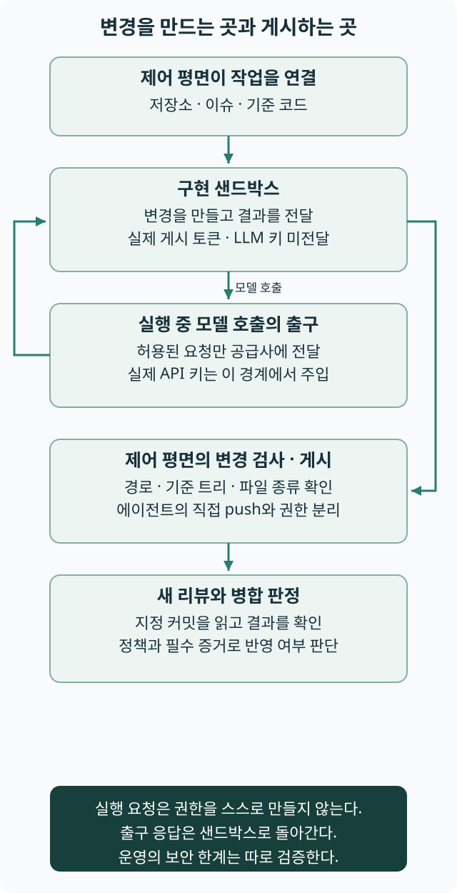

# 만드는 권한과 게시하는 권한

리뉴얼 플랫폼은 에이전트가 변경을 만드는 샌드박스와 저장소에 게시하는 제어 평면을 나눈다. 실제 LLM 키는 출구 핸들러가 주입하고, 컨테이너에는 실제 GitHub 토큰과 LLM 키를 넣지 않는 구조다.[S162]

## 계획과 결과가 권한 경계를 건넌다

제어 평면은 실행할 저장소·이슈·모델과 기준 코드에 작업을 연결한다. 구현 샌드박스가 돌려준 변경 목록은 신뢰하지 않는 입력으로 검사하며, 게시 코드는 기준 트리와 변경 경로·파일 종류 등을 확인해 브랜치와 PR을 만든다. 에이전트에게 게시 토큰을 넘겨 직접 push하게 하는 방식과 구분한다.[S162]

출구 핸들러는 실행에 연결된 저장소와 모델 공급사에 맞는 요청만 허용하도록 구성한다. 키를 쓰는 위치를 경계 밖에 두는 것과, 허용하지 않은 데이터 접근·전송을 실제로 막는지는 함께 확인할 문제다. 코드상의 허용 목록만으로 인젝션과 모든 유출 경로가 해결됐다고 결론 내리지 않는다.

그림 D-2. 실행 요청과 변경은 경계를 건너지만 게시 자격 증명과 실제 LLM 키는 구현 컨테이너에 함께 넘기지 않는다. 모든 보안 위협에 대한 검증 완료를 뜻하지 않는다. [다이어그램 크게 보기](../figures/demo-authority-boundary.svg).

이 실행 요청과 공통 상태 기계는 하네스의 일부다. 책의 실행계획은 이번 업무의 순서·의존성·확인 경로이며, 요청 데이터나 플랫폼 전체와 같은 뜻이 아니다. 필요한 계획이 적절한지와 실제 집행 기반이 경계를 유지하는지 각각 확인한다.

## 구현 근거 읽기

| 확인할 대상 | 역할과 확인할 사실 | 구현 근거 |
|---|---|---|
| 실행 샌드박스 | 실행·리뷰 환경과 요청의 연결 | [환경 경계 읽기](https://github.com/roboco-io/the-software-factory-demo/blob/1a8d3f3a0edbeb0cba6f03b8658a08ee8127ef4a/apps/control/src/agent-sandbox.ts) |
| 출구 정책 | 저장소·공급사별 요청 허용 | [통신 조건 읽기](https://github.com/roboco-io/the-software-factory-demo/blob/1a8d3f3a0edbeb0cba6f03b8658a08ee8127ef4a/apps/control/src/outbound-policy.ts) |
| 변경 검사 | 외부 결과의 경로·형식 확인 | [전달물 검사 읽기](https://github.com/roboco-io/the-software-factory-demo/blob/1a8d3f3a0edbeb0cba6f03b8658a08ee8127ef4a/apps/control/src/changes.ts) |
| 게시 처리 | 기준 트리와 GitHub 반영 권한 | [게시 조건 읽기](https://github.com/roboco-io/the-software-factory-demo/blob/1a8d3f3a0edbeb0cba6f03b8658a08ee8127ef4a/apps/control/src/github-publisher.ts) |

## 리더의 판단과 한계

운영 문서는 DNS와 비루트 실행 등 확인하지 못한 조건을 남긴다. 이 책은 새 환경을 직접 공격·실행 시험하지 않았다. 여러 저장소를 지원하는 제어 평면에서 대상 저장소의 권한과 실행 맥락이 섞이지 않는지도 운영의 확인 대상이다.

2026년 11월 9일 확인한 리뉴얼 플랫폼의 고정 판본을 기준으로 썼다. 문서·코드의 정적 구조를 확인했으며, 에이전트 실행·로그인·병합을 직접 시험하거나 운영 효과를 검증한 결과는 아니다.

[9장으로 돌아가기](../chapters/ch09.md) · [데모 해설 목록](index.md)
