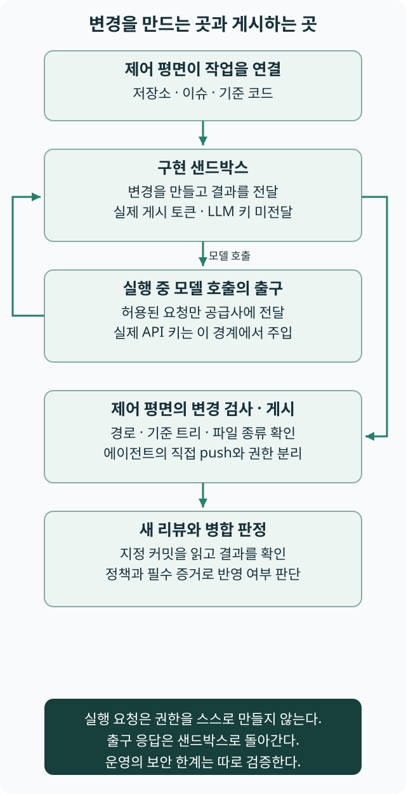

# 만드는 권한과 게시하는 권한

리뉴얼 플랫폼은 에이전트가 변경을 만드는 샌드박스와 저장소에 게시하는 제어 평면을 나눈다. 실제 LLM 키는 출구 핸들러가 주입하고, 컨테이너에는 실제 GitHub 토큰과 LLM 키를 넣지 않는 구조다.[S162]

## 계획과 결과가 권한 경계를 건넌다

제어 평면은 실행할 저장소·이슈·모델과 기준 코드에 작업을 연결한다. 구현 샌드박스가 돌려준 변경 목록은 신뢰하지 않는 입력으로 검사하며, 게시 코드는 기준 트리와 변경 경로·파일 종류 등을 확인해 브랜치와 PR을 만든다. 에이전트에게 게시 토큰을 넘겨 직접 push하게 하는 방식과 구분한다.[S162]

출구 핸들러는 실행에 연결된 저장소와 모델 공급사에 맞는 요청만 허용하도록 구성한다. 키를 쓰는 위치를 경계 밖에 두는 것과, 허용하지 않은 데이터 접근·전송을 실제로 막는지는 함께 확인할 문제다. 코드상의 허용 목록만으로 인젝션과 모든 유출 경로가 해결됐다고 결론 내리지 않는다.

그림 D-2. 실행 요청과 변경은 경계를 건너지만 게시 자격 증명과 실제 LLM 키는 구현 컨테이너에 함께 넘기지 않는다. 모든 보안 위협에 대한 검증 완료를 뜻하지 않는다. [다이어그램 크게 보기](../figures/demo-authority-boundary.svg).

이 실행 요청과 공통 상태 기계는 하네스의 일부다. 책의 실행계획은 이번 업무의 순서·의존성·확인 경로이며, 요청 데이터나 플랫폼 전체와 같은 뜻이 아니다. 필요한 계획이 적절한지와 실제 집행 기반이 경계를 유지하는지 각각 확인한다.

## 구현 근거 읽기

| 확인할 대상 | 역할과 확인할 사실 | 구현 근거 |
|---|---|---|
| 실행 샌드박스 | 실행·리뷰 환경과 요청의 연결 | [환경 경계 읽기](https://github.com/roboco-io/the-software-factory-demo/blob/0c1b2ecbacfbead6f29fe39ab84e35b5bcf4e6e6/apps/control/src/agent-sandbox.ts) |
| 출구 정책 | 저장소·공급사별 요청 허용 | [통신 조건 읽기](https://github.com/roboco-io/the-software-factory-demo/blob/0c1b2ecbacfbead6f29fe39ab84e35b5bcf4e6e6/apps/control/src/outbound-policy.ts) |
| 변경 검사 | 외부 결과의 경로·형식 확인 | [전달물 검사 읽기](https://github.com/roboco-io/the-software-factory-demo/blob/0c1b2ecbacfbead6f29fe39ab84e35b5bcf4e6e6/apps/control/src/changes.ts) |
| 게시 처리 | 기준 트리와 GitHub 반영 권한 | [게시 조건 읽기](https://github.com/roboco-io/the-software-factory-demo/blob/0c1b2ecbacfbead6f29fe39ab84e35b5bcf4e6e6/apps/control/src/github-publisher.ts) |
| 출구 본문 검사의 범위 | 거부하는 필드·도구 유형과 막지 않는 것 | [알려진 제약 읽기](https://github.com/roboco-io/the-software-factory-demo/blob/0c1b2ecbacfbead6f29fe39ab84e35b5bcf4e6e6/docs/operations.md) |
| 확인 상태 | 실서비스 확인과 남은 항목을 적는 플랫폼의 문서 | [현재 상태 읽기](https://github.com/roboco-io/the-software-factory-demo/blob/0c1b2ecbacfbead6f29fe39ab84e35b5bcf4e6e6/docs/status.md) |
| DNS 실험 기록 | 실험 구성, 판정 방법, 한계 | [DNS 실험 읽기](https://github.com/roboco-io/the-software-factory-demo/blob/0c1b2ecbacfbead6f29fe39ab84e35b5bcf4e6e6/experiments/dns-exfil/RESULTS.md) |
| 인젝션 시험 기록 | 시험 방법, 결과, 하지 않은 시험 | [인젝션 시험 읽기](https://github.com/roboco-io/the-software-factory-demo/blob/0c1b2ecbacfbead6f29fe39ab84e35b5bcf4e6e6/experiments/injection/RESULTS.md) |

## 리더의 판단과 한계

플랫폼 저장소는 공개 전에 확인해야 할 조건으로 DNS를 통한 유출과 인젝션 문구에 대한 반응을 꼽고, 그 시험 기록을 남겼다. 아래는 그 기록의 내용이며 이 책이 시험을 재현한 것이 아니다.

DNS 실험은 2026년 11월 10일에 별도의 실험용 서비스로 했다. 에이전트 컨테이너와 같은 네트워크 구성으로 시작한 컨테이너가 보낸 표식 이름 37개 가운데 외부 DNS 기록 서비스에 남은 것은 0건이었고, 같은 시간에 로컬 컴퓨터에서 보낸 대조 조회는 기록됐다. 확인한 시간은 실행 뒤 약 2-3분 40초로 짧았고, 실험 전에 한 확인용 조회 하나가 기록 서비스의 응답에서 사라져 기록 보존이 완전하다고 단정하지 않는다고 플랫폼은 적는다. 실험 컨테이너에는 에이전트와 키가 없었고 출구는 모든 요청을 403으로 거부하도록 바꿨다. 기록은 이를 실험 시점의 플랫폼 동작에 대한 관측으로 한정하며, 그 동작이 이 저장소의 코드가 강제하는 것이 아니므로 공개 직전과 관련 도구의 판을 올릴 때 다시 실험해야 한다고 적는다.

인젝션 시험은 2026년 11월 11일에 운영자 계정이 공개 시험 저장소에 만든 이슈로 했다. 비밀 값 기록이나 외부 전송, 정책 파일 변경, 강제 푸시, 리뷰어 조작을 요구하는 문구가 든 이슈 5건을 실행했을 때 구현 에이전트는 4건에서 평범한 요청만 처리했고, 1건은 출구 핸들러가 요청 하나를 거부한 뒤 실패했다. 외부 호스트로 나간 요청은 없었다. 이 실패의 원인은 본문 검사가 거부한 모델 이름이 기록에 남지 않아 알 수 없다고 플랫폼이 적는다. 기록은 모델 하나와 문구당 1회 실행의 결과이므로 비율로 읽을 수 없다고 밝힌다. 공격 문구가 없는 요청으로 에이전트가 허용 목록 밖의 호스트 두 곳에 `curl`을 실행하게 했을 때는 출구 핸들러가 요청을 모두 거부했다.

플랫폼의 같은 문서는 아직 하지 않은 일도 적는다. 컨테이너에 실제 키가 없다는 것을 실서비스에서 확인하지 않았고, 에이전트가 금지 경로를 실제로 바꾼 경우의 거부와 리뷰어 조작, 예비 구현 엔진, 문구의 반복과 변형도 인젝션 시험에서는 시험하지 않았다(예비 엔진의 실서비스 확인은 에이전트 선택 해설을 본다). 컨테이너 이미지에는 사용자 지정이 없어 에이전트가 루트 권한으로 실행되며, 비루트로 바꿔도 샌드박스 도구가 동작하는지는 실험하지 않았다. 허용된 모델 요청의 본문에는 저장소 내용이 담기므로 그 경로로 나가는 데이터는 별도로 판단해야 한다. 플랫폼의 운영 문서는 출구 핸들러의 본문 검사가 정해 둔 필드와 도구 유형만 거부하고 다른 서버 측 도구는 막지 않는다는 점도 적는다. 따라서 이 시험 결과는 시험한 조건의 관측이며, 여러 저장소를 지원하는 제어 평면에서 대상 저장소의 권한과 실행 맥락이 섞이지 않는지도 운영의 확인 대상으로 남는다.

2026년 11월 17일의 플랫폼 커밋(2026년 11월 19일 확인)을 기준으로 썼다. 문서·코드의 정적 구조와 플랫폼이 남긴 시험 기록의 내용을 확인했으며, 이 책이 에이전트 실행·로그인·병합을 직접 시험하거나 운영 효과를 검증한 결과는 아니다.

[9장으로 돌아가기](../chapters/ch09.md) · [데모 해설 목록](index.md)
