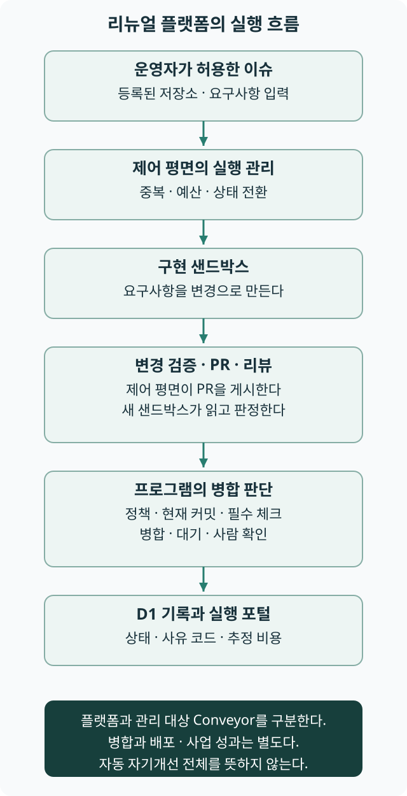

# 데모 해설

리뉴얼된 Software Factory는 여러 저장소의 이슈 구현·리뷰·병합을 관리하는 플랫폼이다. 이전 예제 앱은 **Conveyor**라는 별도 프로젝트로 남아 새 플랫폼의 관리 대상이 되었다. 이 해설은 두 대상을 구분해 책의 원리를 읽는다.[S157]

## 먼저 볼 흐름

운영자가 실행을 허용한 이슈를 제어 평면이 접수하고, 구현 샌드박스가 변경을 만든다. 제어 평면은 전달받은 변경을 검사해 PR을 만들며, 새 샌드박스의 리뷰와 GitHub 체크를 근거로 프로그램이 병합·대기·사람 이관을 판정한다. 실행 상태와 사건은 데이터베이스에 연결되고 포털이 그 흐름을 보여 준다.[S157]

책의 하네스는 이 실행·권한·판정·기록의 연결과 운영 개선을 포함하는 체계다. 데모의 공통 실행 순서와 이슈 데이터가 있다는 사실만으로 업무별 실행계획 산출물이나 의도 개선·자기개선 루프 전체가 완성됐다고 보지는 않는다. 현재 플랫폼의 병합 종료와 관리 대상 서비스의 배포·사용자 결과도 구분한다. 책이 목표로 하는 완전 자동화와 이번 구현의 범위는 다르다.

그림 D-1. 리뉴얼 플랫폼의 현재 연결이다. 플랫폼은 실행을 관리하고, Conveyor는 그 플랫폼이 관리하는 예제 서비스다. 모든 화살표가 무조건 다음 단계로 진행한다는 뜻은 아니다. [다이어그램 크게 보기](../figures/demo-flow.svg).

## 질문으로 찾아보기

| 알고 싶은 것 | 해설 | 연결 장 |
|---|---|---|
| 누가 어떤 요청의 시작을 허용하는가 | [요청에서 실행 가능한 작업까지](request.md) | [5장](../chapters/ch05.md) |
| 대상 저장소의 정책이 병합 판단에 어떻게 연결되는가 | [정책과 수용 경계](policy-and-gate.md) | [3장](../chapters/ch03.md)·[12장](../chapters/ch12.md) |
| 리뷰 판정과 실제 검사 증거는 어떻게 다른가 | [결과를 판단하는 증거](evidence.md) | [7장](../chapters/ch07.md) |
| 중지 요청과 실행 종료·복구는 어떻게 다른가 | [실패에서 복구로](recovery.md) | [8장](../chapters/ch08.md) |
| 에이전트의 변경을 누가 어떤 권한으로 게시하는가 | [만드는 권한과 게시하는 권한](execution-authority.md) | [9장](../chapters/ch09.md) |
| 예산 변화 때 구현·리뷰 조합을 어떻게 바꾸는가 | [에이전트 선택과 평가](agent-selection.md) | [11장](../chapters/ch11.md) |
| 실행 상태와 추정 비용은 무엇을 보여 주는가 | [활동과 성과를 구분하는 지표](metrics.md) | [17장](../chapters/ch17.md) |
| 관찰 기록과 자동 자기개선의 구현 범위는 어떻게 다른가 | [관찰을 개선으로 연결하기](improvement.md) | [19장](../chapters/ch19.md) |

## 자료를 읽는 순서

각 페이지의 설명을 먼저 읽고 ‘구현 근거’ 표에서 관계를 확인한다. 이번 판본은 2026년 11월 9일의 플랫폼 코드와 문서를 기준으로 한다. 소개 페이지·포털·Conveyor의 HTTP 응답을 확인했지만, 페이지 응답이 모든 기능의 정상 동작이나 신규 실행의 성공을 입증하지는 않는다. 로그인·실제 에이전트 작업과 운영 성과는 이 책에서 시험하지 않았다.

[플랫폼 소개](https://roboco.io/the-software-factory-demo/) · [실행 포털](https://software-factory-control.roboco.workers.dev/projects/roboco-io/conveyor) · [관리 대상 Conveyor](https://roboco.io/conveyor/) · [플랫폼 저장소](https://github.com/roboco-io/the-software-factory-demo)

## 이전 구현과 현재 플랫폼을 구분한다

이전의 GitHub Actions·라벨·트리아지·개선 PR 사례는 Conveyor 저장소의 당시 판본에 남아 있다. 새 플랫폼과 동일한 구현으로 설명하지 않는다. 특히 2026년 10월의 자기개선 리허설은 [과거 실행 기록](improvement.md)의 역사 사례다. 이전 주소로 연결되던 책 토론 링크는 이제 Conveyor 포럼으로 연결한다.

리뉴얼 안내 중에 표시했던 일시 이용 불가 문구는 해제했다. 플랫폼 소개, 실행 포털, Conveyor 서비스는 서로 다른 읽기 목적을 가진다. 플랫폼의 모든 계획 기능과 공개 체험 조건까지 완료됐다는 뜻은 아니다.

[1장으로 돌아가기](../chapters/ch01.md)
